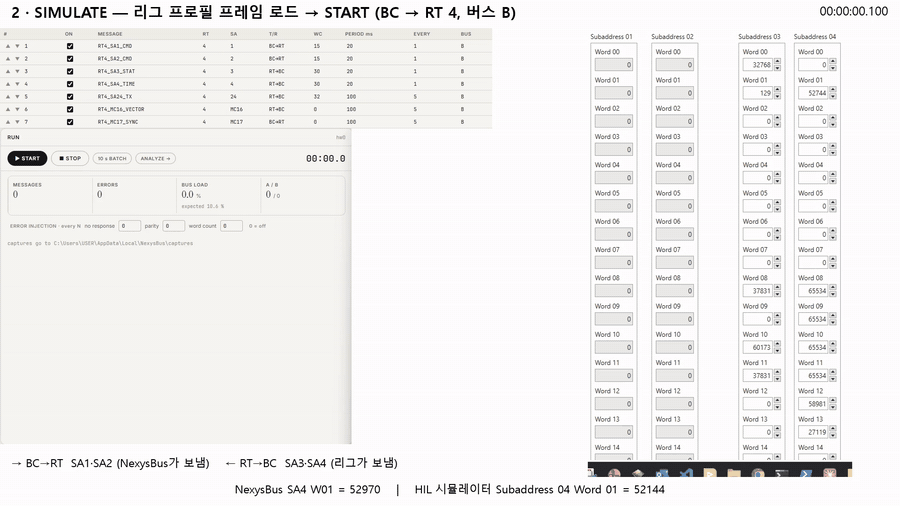
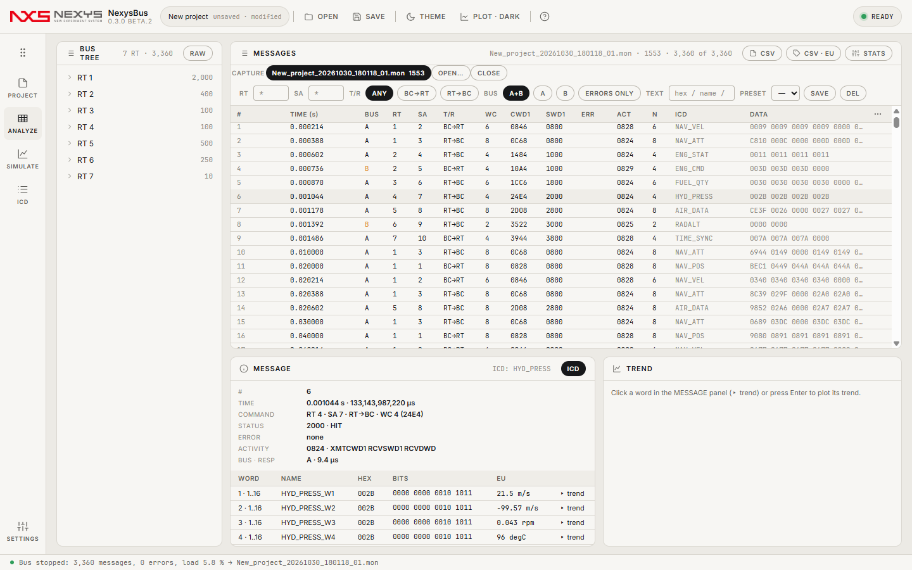

<p align="center"></p>

# NexysBus

**MIL-STD-1553 버스 시뮬레이션 · ARINC 664(AFDX) 캡처·검사·송신 · 캡처 분석 · ICD — 가상 버스/네트워크로 지금 바로, 하드웨어는 드라이버(또는 패킷 캡처 라이브러리)가 있는 PC에서 같은 화면으로.**

   

C# 12 / .NET 8 · WPF 창 + WebView2 페이지(TypeScript) · 엔진은 [nexys-core](https://github.com/Kim-Hakseong/nexys-core) submodule

## 데모 영상 — 실제 카드 ↔ HIL 시뮬레이터 RT 4 양방향 검증
[](https://github.com/Kim-Hakseong/nexys-bus/releases/download/v0.3.0-beta.2/nexysbus-demo.mp4)

USB 1553 카드(단일 기능 채널 2개)를 BC로 HIL 시뮬레이터의 RT 4(버스 B)와 주고받는 장면입니다. 카드 인식 → 프레임 로드·START → SA4 시간 카운터·SA3 상태 워드를 양쪽 화면에서 비교 → 상대 RT를 멈추면 NO RESPONSE가 쌓이고 다시 켜면 복구 → 통계.
영상 파일은 [v0.3.0-beta.2 Release](https://github.com/Kim-Hakseong/nexys-bus/releases/tag/v0.3.0-beta.2)에 첨부돼 있습니다: **전체(2분 6초)** [nexysbus-demo.mp4](https://github.com/Kim-Hakseong/nexys-bus/releases/download/v0.3.0-beta.2/nexysbus-demo.mp4) · **60초 요약** [nexysbus-demo-60s.mp4](https://github.com/Kim-Hakseong/nexys-bus/releases/download/v0.3.0-beta.2/nexysbus-demo-60s.mp4) · 자막 [srt](https://github.com/Kim-Hakseong/nexys-bus/releases/download/v0.3.0-beta.2/nexysbus-demo.srt)

## 사용 가이드
처음 쓰는 분은 **[사용 가이드](docs/guide/README.md)**부터 보세요 — 설치, 화면 구성, 5분 따라 하기, PROJECT · ICD · SIMULATE · ANALYZE 기능별 설명, 하드웨어 카드 연결, 자동화·현장 측정, 파일 형식·단축키·문제 해결(8장, 화면 그림 포함). 앱 안에서는 F1.

| [1. 시작하기](docs/guide/01-getting-started.md) | [2. PROJECT](docs/guide/02-project.md) | [3. ICD](docs/guide/03-icd.md) | [4. SIMULATE](docs/guide/04-simulate.md) |
|---|---|---|---|
| [**5. ANALYZE**](docs/guide/05-analyze.md) | [**6. 하드웨어 카드**](docs/guide/06-hardware.md) | [**7. 자동화·현장 측정**](docs/guide/07-automation.md) | [**8. 파일·단축키·FAQ**](docs/guide/08-reference.md) |
| [**9. ARINC 664 (AFDX)**](docs/guide/09-arinc664.md) | | | |

> **0.4.0 beta.2 — ARINC 664 상호운용**: 큐잉 포트의 큰 메시지(IP 단편화) 송신·재조립 검사, 서브 VL 라운드로빈 송신·순서 검사, VL 식별 폴백(목적지 IP 224.224.x.x · ICD UDP 포트 · UDP 포트 맵 — 표준 AFDX MAC을 쓰지 않는 프로그램용), ANALYZE › LISTEN(수신 전용), 공유 가상 네트워크로 **NexysBus 두 인스턴스 상호운용**(한 PC), INTEROP 근거 프레임 링크 · 상대 보고 CSV 가져오기 · Wireshark 프로필 내보내기(VL · SN · A/B 열, 색, 파라미터 디코드). Wireshark(tshark 4.6.9) 교차 대조 340/340, 정답지 2259/2259. 실제 NIC(Npcap) 수신 확인, Wi-Fi 어댑터는 원시 프레임 송신을 거절함을 표시.
>
> **0.4.0 beta.1 — ARINC 664(AFDX)**: Wireshark로 하던 664 송수신 확인을 NexysBus 안에서 — pcapng 캡처 열기/쓰기(인터페이스 = 네트워크 A/B), VL · SN · A/B · ICD 파라미터 EU 디코드, SN 무결성 · BAG · Lmax · 이중화(RM)/스큐 검사, VL 송신 시뮬레이션(BAG 스케줄러, SN 자동, A/B, 오류 주입), 상호운용 체크리스트와 `interop-report.md`. 가상 네트워크는 항상, 이더넷 포트는 Npcap(별도 설치, 동봉하지 않음)이 있는 PC에서. 정답지 코퍼스 2039/2039, 100만 프레임 열기+검사 0.3 s. 자세한 것은 [9장](docs/guide/09-arinc664.md).
>
> 0.3.0 beta.2: 실제 USB 1553 카드와 외부 RT로 측정을 마친 첫 버전대(응답률 100 %, 10분 연속 138,003 / 138,000 명령, 놓친 트랜잭션 0.05 %). 사이트 프로필, 채널 능력 기반 역할 배정, 장비 설정 XML 가져오기, 모드 코드를 지원합니다. 문제는 [GitHub Issues](https://github.com/Kim-Hakseong/nexys-bus/issues)로.

[](docs/guide/images/08_analyze.png)

* * *

## 설치와 실행
- **설치형**: [Releases](https://github.com/Kim-Hakseong/nexys-bus/releases)의 `NexysBus-0.4.0-beta.2-setup.exe`. Program Files에 설치, `.nxb`/`.mon` 연결은 선택(기본 해제). WebView2 런타임이 없으면 설치 중 받는다.
- **포터블**: `NexysBus-0.4.0-beta.2-portable.exe` 1개. 첫 실행은 `%TEMP%\.net\NexysBus\`에 풀리느라 5–12 s, 이후 약 2 s.
- **소스**: `git clone --recurse-submodules` → `cd app/web && npm install && npm run build` → `dotnet build app/NexysBus.App/NexysBus.App.csproj -c Release` → `app\NexysBus.App\bin\Release\net8.0-windows\win-x64\NexysBus.exe`

## 화면 (왼쪽 레일)
| 레일 | 내용 |
|---|---|
| **시작** | NEW PROJECT · OPEN PROJECT… · SEARCH HARDWARE(드라이버 바인딩 `driver.json`이 있는 PC에서 활성 → 카드 열거) · 최근 프로젝트 |
| **PROJECT** | 이름·파일(.nxb JSON)·캡처 폴더 · 장치(Virtual bus / 드라이버 카드) · 버스 설정(채널·마이너 프레임·RT 응답·갭·시드) · ICD 요약 + **시뮬레이터 프로젝트 가져오기/내보내기**(복합문서) |
| **SIMULATE** | **RUN**에 프레임 표 기준 expected bus load 상시 표시 · **FRAME** 표(순서 ▲▼·ON·주기 ms → EVERY = 몇 번째 마이너 프레임마다) + 메이저 프레임 안 배치 격자 · **SIMULATED RT DATA**(메시지별 데이터 소스: eu = 각 워드 범위의 사인을 scale·offset 역변환, sine·ramp·const) · **RUN**(START/STOP 실시간, 10 s BATCH 즉시 생성, 메시지·오류·버스 로드·A/B·RT별, **ERROR INJECTION** 무응답·패리티·워드카운트 every N) |
| **ANALYZE** | **BUS TREE**(RT → SA(T/R) → ICD 워드, 노드마다 메시지·오류 수; RAW 토글은 채널 목록) · 실행 중 캡처가 실시간으로 쌓이는 리스트(100만 건 가상 스크롤) · CAPTURE 칩 · 한 줄 필터(RT/SA/T·R/BUS/ERRORS ONLY/TEXT/PRESET) · 머리글 ⋯ 메뉴(시간 표시 REL/ABS µs(상위 32비트 미확정 툴팁)/Δ, 열 선택) · 패널 헤더 CSV / CSV·EU / STATS · ERR 열은 오류 비트만(HIT는 STAT 열, 기본 숨김) · 디코드(hex · 4비트 묶음 비트 · EU) · 추이 카드(워드·단위 · LAST 10 s / 60 s / ALL · SEND TO VIEW) · 통계. ARINC 429 캡처도 같은 화면 |
| **ICD** | IMPORT(CSV/XLSX 열 매핑·허브 JSON·메시지 XML) · EDIT(표 편집·검증: 비트 겹침 error, 중복 warning) · EXPORT(시뮬레이터 프로젝트·메시지 XML·커스텀 디바이스 XML·자동화 스크립트, XSD + 재판독). 가져온 ICD는 곧바로 프로젝트의 프레임이 된다 |
| **SETTINGS** | 테마·플롯 · ANALYZE 시간 표시 · 템플릿 프로젝트 폴더(시뮬레이터 내보내기용, RT/SA 노드가 있는 템플릿) · 캡처 폴더 · 설정 파일(`%LOCALAPPDATA%\NexysBus\settings.json`) |
| **INTEROP** (ARINC 664 프로젝트) | PEER → NEXYSBUS 자동 판정(VL 수신 · ICD 밖 VL · SN · BAG · Lmax · A/B · 스큐 · 디코드) · NEXYSBUS → PEER 표(보낸 수 vs 상대 보고) · EXPORT REPORT… → `interop-report.md` |

ARINC 664 프로젝트(시작 화면 **NEW ARINC 664 PROJECT** 또는 PROJECT › PROTOCOL)에서는 ICD(VL → 포트 → 파라미터, 허브 스키마 1.1) · SIMULATE(VL 송신, BAG 스케줄러, SENDER FAULTS, VIRTUAL NETWORK 지연·손실·스큐) · ANALYZE(VL 트리 · 100만 프레임 목록 · 필터 · 디코드 · VL별 검사표 · 추이)가 664 화면으로 바뀝니다. [가이드 9장](docs/guide/09-arinc664.md).

## 수치 (0.2.0-beta.1, 가상 버스, 셀프테스트 `--bus` 측정)
| 항목 | 값 | 기준 |
|---|---|---|
| 시작 → 페이지 준비 | 2.4 s | ≤ 3 s |
| 더미 ICD 10메시지 프레임, 10 s 가상 실행 | 메시지 3,360 = Σ ⌈10 s / 주기⌉ (독립 계산 3,360) | ±0 |
| 버스 로드: 장치 계산 vs ANALYZE 통계 | 5.715 % = 5.715 % | 일치 |
| 디코드 EU vs 입력 파형(NAV_POS, eu 소스, 800 워드) | 최대 오차 0 (양자화 scale/2 이내) | 숫자 |
| 오류 주입(무응답 every 50) vs ERRORS ONLY 필터 | 67 = 67 | 동일 |
| 라이브 실행 0.6 s → 1.2 s 리스트 | 225 → 증가, 정지 시 .mon 저장 | — |
| 프로젝트 저장 → 닫기 → 최근에서 열기 | JSON 동일 | — |
| 템플릿 가져오기 → 내보내기 → 다시 가져오기 | 비트 범위·타입·scale 동일(프로젝트 파일에는 offset/unit이 없음) | — |
| 설정 4절 · 도움말 7절 · 정보 창 타사 이름 0 · accent 테두리 0 · 종료 WS 211 MB | — | ≤ 600 MB |

뷰어에서 옮겨 온 BUS/ICD 관문(`--v100rc` 31 관문 + UI 피드백 관문 12, `--v0100` 1M 레코드 성능)도 그대로 통과한다 — [docs/bus-report.md](docs/bus-report.md). beta.2는 UI 피드백 10항목(ERR/STAT 분리, ABS 시간 툴팁, 한 줄 필터 바, BUS TREE, 추이 카드 헤더, 비트 묶음, ICD 푸터, 개발자 전용 DUMMY, 내부 식별자 제거, 영문 UI)을, beta.3은 피드백 2의 8항목(EXPORT 블록, EU 열 55:45, BUS 열·버튼 폭, 시작 버튼 라벨, 영문 관문 확장, 다크 강조색 1종, SETTINGS 카드, RUN expected load)을 반영했다.

## 하드웨어 카드
카드 드라이버는 **정적으로 링크하지 않는다** — 배포물에 드라이버 라이브러리도, 그 이름도 없다. 실행 시 `driver.json`(exe 옆 또는 `%LOCALAPPDATA%\NexysBus\`)을 읽어 `NativeLibrary.Load` + `GetExport(prefix + "CardOpen")`로 묶는다:
```json
{ "cardLibrary": "<card API dll>", "busLibrary": "<1553 API dll>", "cardPrefix": "<CardApi>_", "busPrefix": "<BusApi>_", "maxCards": 4 }
```
- 파일이 없으면 SEARCH HARDWARE 비활성, 장치 목록은 Virtual bus만 — 예외 없음. 있으면 시작 화면·PROJECT의 **SEARCH HARDWARE**가 카드를 열거하고(타입·제품·S/N·1553 채널 수·**채널마다 단일/다중 기능**) PROJECT › DEVICE에서 고른다.
- 채널 역할은 한 곳(`ChannelRoles`)에서 정한다: 다중 기능 채널은 BC + 시뮬레이트 RT + 모니터, 단일 기능 채널은 BC만(옆에 RT·모니터를 구성하면 드라이버가 BC 스케줄까지 지운다는 것이 실측으로 확인돼 아예 시도하지 않음) — BC 기록은 메시지 블록을 5 ms마다 읽어 시간순으로, 전체 버스 모니터는 두 번째 채널(MONITOR CH).
- 실측(USB 1553 카드 ↔ 외부 RT 4, 버스 B): 30 s 6,896 / 6,900 명령·응답률 100 %·DATA COUNT 오류 0·모드 코드 16/17 응답, 10 min 138,003 / 138,000·누락 0.05 %·시간 역순 0·메모리 +42 MB, 타임태그 = µs. 자세한 것은 [가이드 6장](docs/guide/06-hardware.md).

## ARINC 664 네트워크 포트
패킷 캡처 라이브러리(Npcap)는 **배포물에 넣지 않는다** — 설치돼 있으면(`%SystemRoot%\System32\Npcap\wpcap.dll`) 실행 시 묶어서 PROJECT › DEVICE의 Ethernet ports와 NETWORK A / B 포트 선택이 켜지고, 없으면 Virtual network만 보인다(1553 `driver.json`과 같은 방식). 전용 AFDX 카드는 인터페이스 자리만 있다.

## 자동화
`NexysBus.exe --afdx --out <dir> [--corpus <dir>] [--tshark <dir>]`(ARINC 664 사용자 경로 + 정답지 + Wireshark 대조 + 100만 프레임 + 실시간 BAG 관문; `--rtonly --rtmode sleep|hires|spin`, `--perfonly --frames N`), `--interop --transport local|nic [--nic <port>] --out <dir>`(NexysBus 두 인스턴스 송신↔수신 대조), `NexysBus.exe --bus --out <dir> [--template <folder>] --forbid a,b,c`(사용자 경로 전체), `--v100rc --out <dir> [--xlsx <file>] [--template <folder>] --forbid …`(ANALYZE·ICD + UI 피드백 관문), `--hw --out <dir> …`(하드웨어 카드 G1~G7), `--site --out <dir> --profile <json>`(현장 측정, [사이트 프로필](docs/site-profile.md)), `--icdxml --dev <xml> --par <xml> --truth <csv>`(장비 설정 XML 가져오기 검증), `--v0100 --out <dir> [--truth <mon>]`, `--stress --iter 50`, `--uishots --out <dir> --prefix before|after`(피드백 10장면 캡처), `--uishots2 …`(피드백 2의 8장면), `--shot --rail SIMULATE --name x`. UI는 영문, 도움말(F1)만 한글. `Ctrl+Shift+D` 개발자 모드(ICD 푸터 DUMMY).

## 파일
- `.nxb` 프로젝트(JSON, 버전 1): protocol(mil1553 · arinc664) · device · bus · icd(허브 스키마 1.0, 664는 1.1 `vls`) · schedule · sources · errors · captureDir · afdx(664 설정).
- `.pcapng` / `.pcap` ARINC 664 캡처: 인터페이스 = 네트워크 A/B, NexysBus가 쓰는 파일은 ns 타임스탬프·FCS 없음. Wireshark/dumpcap 파일을 그대로 연다.
- `.mon` 캡처: 복합문서 메타 + 120 B 고정 레코드 + 끝 u32 오프셋(뷰어와 동일 리더). 실행 중에는 메모리에서 자라고 STOP에서 저장.

## 개발
```
app/NexysBus.App/   Program · App · MainWindow(호스트 명령) · Services/BusEngine(프로젝트·레일·브리지 명령) · Services/SimulationService(장치 실행·라이브 캡처) · Services/AfdxService(ARINC 664: 송수신·검사·추이·상호운용, 664 프로젝트에서만 생성) · SelfTest*(--bus · --v100rc · --v0100 · --stress · --afdx · --interop)
app/web/            main(레일 셸) · start · project · simulate · analyze(리스트) · icd · afdx(664 ICD·SIMULATE·ANALYZE·INTEROP) · settings · help · bus.css ; 공통은 @core(app/core/NexysView.Web)
app/core/NexysView.Core/Protocols/   Mil1553 · Arinc664(pcapng · 프레임 · 검사 · ICD 1.1 · 가상/NIC 장치 · 송신 스케줄러)
app/core/           nexys-core submodule (Core · Render · Host · Web)
design/mockup/      bus-start · bus-project · bus-simulate (HTML → PNG → 구현)
installer/          NexysBus.iss
```

## 라이선스
MIT — [LICENSE.txt](LICENSE.txt).
