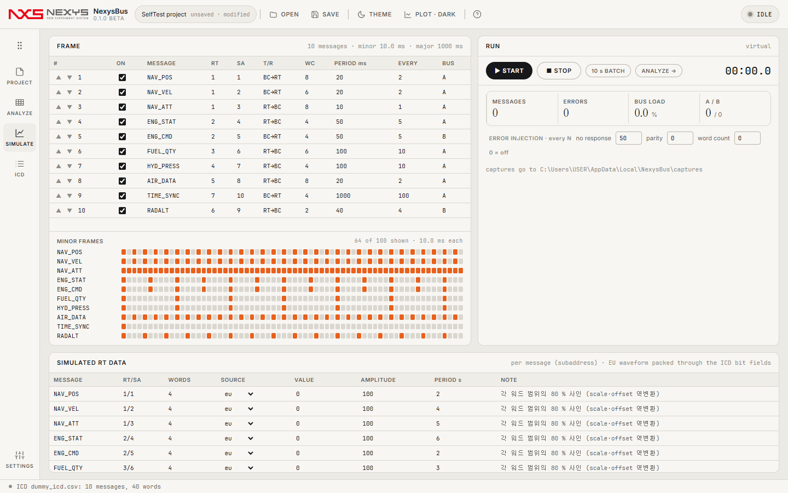

<p align="center"></p>

# NexysBus

**MIL-STD-1553 버스 시뮬레이션 · 캡처 분석 · ICD — 가상 버스로 지금 바로, 하드웨어 카드는 드라이버가 있는 PC에서 같은 화면으로.**

   

C# 12 / .NET 8 · WPF 창 + WebView2 페이지(TypeScript) · 엔진은 [nexys-core](https://github.com/Kim-Hakseong/nexys-core) submodule

> ⚠️ 0.1.0 beta. 앱 이름은 임시이고(결정 항목), 하드웨어 카드 지원은 다음 단계다(`HardwareBusDevice`는 서명만). 모든 수치는 가상 버스·가상 데이터 기준. 문제는 [GitHub Issues](https://github.com/Kim-Hakseong/nexys-bus/issues)로.

[](docs/images/simulate.png)

* * *

## 설치와 실행
- **설치형**: [Releases](https://github.com/Kim-Hakseong/nexys-bus/releases)의 `NexysBus-0.1.0-beta-setup.exe`. Program Files에 설치, `.nxb`/`.mon` 연결은 선택(기본 해제). WebView2 런타임이 없으면 설치 중 받는다.
- **포터블**: `NexysBus-0.1.0-beta-portable.exe` 1개. 첫 실행은 `%TEMP%\.net\NexysBus\`에 풀리느라 5–12 s, 이후 약 2 s.
- **소스**: `git clone --recurse-submodules` → `cd app/web && npm install && npm run build` → `dotnet build app/NexysBus.App/NexysBus.App.csproj -c Release` → `app\NexysBus.App\bin\Release\net8.0-windows\win-x64\NexysBus.exe`

## 화면 (왼쪽 레일)
| 레일 | 내용 |
|---|---|
| **시작** | NEW PROJECT · OPEN PROJECT… · SEARCH HARDWARE(드라이버 카드가 있는 PC에서 활성) · 최근 프로젝트 |
| **PROJECT** | 이름·파일(.nxb JSON)·캡처 폴더 · 장치(Virtual bus / 드라이버 카드) · 버스 설정(채널·마이너 프레임·RT 응답·갭·시드) · ICD 요약 + **시뮬레이터 프로젝트 가져오기/내보내기**(복합문서) |
| **SIMULATE** | **FRAME** 표(순서 ▲▼·ON·주기 ms → EVERY = 몇 번째 마이너 프레임마다) + 메이저 프레임 안 배치 격자 · **SIMULATED RT DATA**(메시지별 데이터 소스: eu = 각 워드 범위의 사인을 scale·offset 역변환, sine·ramp·const) · **RUN**(START/STOP 실시간, 10 s BATCH 즉시 생성, 메시지·오류·버스 로드·A/B·RT별, **ERROR INJECTION** 무응답·패리티·워드카운트 every N) |
| **ANALYZE** | 실행 중 캡처가 실시간으로 쌓이는 리스트(100만 건 가상 스크롤) · CAPTURE 칩으로 캡처 전환 · 정렬·열 선택·시간 단위·키보드 · 필터(RT/SA/T·R/버스/오류/텍스트 + 프리셋) · 디코드(hex·비트·10진 + ICD 워드 EU) · 추이 차트 · 통계 · CSV. ARINC 429 캡처도 같은 화면 |
| **ICD** | IMPORT(CSV/XLSX 열 매핑·허브 JSON·메시지 XML) · EDIT(표 편집·검증: 비트 겹침 error, 중복 warning) · EXPORT(시뮬레이터 프로젝트·메시지 XML·커스텀 디바이스 XML·자동화 스크립트, XSD + 재판독). 가져온 ICD는 곧바로 프로젝트의 프레임이 된다 |
| **SETTINGS** | 테마·플롯 · ANALYZE 시간 표시 · 템플릿 프로젝트 폴더(시뮬레이터 내보내기용, RT/SA 노드가 있는 템플릿) · 캡처 폴더 · 설정 파일(`%LOCALAPPDATA%\NexysBus\settings.json`) |

## 수치 (0.1.0-beta, 가상 버스, 셀프테스트 `--bus` 측정)
| 항목 | 값 | 기준 |
|---|---|---|
| 시작 → 페이지 준비 | 2.4 s | ≤ 3 s |
| 더미 ICD 10메시지 프레임, 10 s 가상 실행 | 메시지 3,360 = Σ ⌈10 s / 주기⌉ (독립 계산 3,360) | ±0 |
| 버스 로드: 장치 계산 vs ANALYZE 통계 | 5.715 % = 5.715 % | 일치 |
| 디코드 EU vs 입력 파형(NAV_POS, eu 소스, 800 워드) | 최대 오차 0 (양자화 scale/2 이내) | 숫자 |
| 오류 주입(무응답 every 50) vs ERRORS ONLY 필터 | 67 = 67 | 동일 |
| 라이브 실행 0.6 s → 1.2 s 리스트 | 225 → 증가, 정지 시 .mon 저장 | — |
| 프로젝트 저장 → 닫기 → 최근에서 열기 | JSON 동일 | — |
| 템플릿 가져오기 → 내보내기 → 다시 가져오기 | 비트 범위·타입·scale 동일(프로젝트 파일에는 offset/unit이 없음) | — |
| 설정 4절 · 도움말 7절 · 정보 창 타사 이름 0 · accent 테두리 0 · 종료 WS 211 MB | — | ≤ 600 MB |

뷰어에서 옮겨 온 BUS/ICD 관문(`--v100rc` 31 관문, `--v0100` 1M 레코드 성능)도 그대로 통과한다 — [docs/bus-report.md](docs/bus-report.md).

## 자동화
`NexysBus.exe --bus --out <dir> [--template <folder>] --forbid a,b,c`(사용자 경로 전체), `--v100rc --out <dir> [--xlsx <file>] [--template <folder>] --forbid …`, `--v0100 --out <dir> [--truth <mon>]`, `--stress --iter 50`, `--shot --rail SIMULATE --name x`.

## 파일
- `.nxb` 프로젝트(JSON, 버전 1): device · bus · icd(허브 스키마 1.0) · schedule · sources · errors · captureDir.
- `.mon` 캡처: 복합문서 메타 + 120 B 고정 레코드 + 끝 u32 오프셋(뷰어와 동일 리더). 실행 중에는 메모리에서 자라고 STOP에서 저장.

## 개발
```
app/NexysBus.App/   Program · App · MainWindow(호스트 명령) · Services/BusEngine(프로젝트·레일·브리지 명령) · Services/SimulationService(장치 실행·라이브 캡처) · SelfTest*(--bus · --v100rc · --v0100 · --stress)
app/web/            main(레일 셸) · start · project · simulate · analyze(리스트) · icd · settings · help · bus.css ; 공통은 @core(app/core/NexysView.Web)
app/core/           nexys-core submodule (Core · Render · Host · Web)
design/mockup/      bus-start · bus-project · bus-simulate (HTML → PNG → 구현)
installer/          NexysBus.iss
```

## 라이선스
MIT — [LICENSE.txt](LICENSE.txt).
