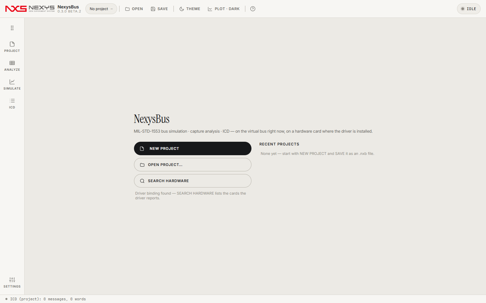

# 1. 시작하기

## 1.1 설치
| 방법 | 파일 | 비고 |
|---|---|---|
| 설치형 | [Releases](https://github.com/Kim-Hakseong/nexys-bus/releases)의 `NexysBus-<버전>-setup.exe` | Program Files에 설치. `.nxb`·`.mon` 파일 연결은 선택(기본 해제). WebView2 런타임이 없으면 설치 중에 받습니다. |
| 포터블 | `NexysBus-<버전>-portable.exe` 한 개 | 설치 없이 실행. 첫 실행은 임시 폴더에 풀리느라 5–12초, 이후 약 2초. USB에 넣어 다니기 좋습니다. |
| 소스 | `git clone --recurse-submodules` → `app/web`에서 `npm install && npm run build` → `dotnet build app/NexysBus.App/NexysBus.App.csproj -c Release` | .NET 8 SDK, Node.js 필요 |

요구 사항: Windows 10/11 x64. 하드웨어 카드를 쓸 때만 카드 드라이버가 설치된 PC가 필요합니다([6장](06-hardware.md)).

## 1.2 화면 구성

- **왼쪽 레일**: PROJECT · ANALYZE · SIMULATE · ICD · SETTINGS. `Ctrl+1`~`Ctrl+5`로도 옮겨 다닙니다.
- **상단 바**: 프로젝트 칩(이름·저장 여부), OPEN, SAVE, THEME(밝게/어둡게), PLOT(그래프 밝기), `?`(도움말), 오른쪽 끝 상태 표시(IDLE · BUSY · READY · ERROR).
- **하단 상태줄**: 마지막 동작의 결과 한 줄(예: `Bus stopped: 2,994 messages, 0 errors, load 13.6 %`). 무슨 일이 있었는지 모를 때 먼저 여기를 보세요.
- **시작 화면**: NEW PROJECT, OPEN PROJECT…, SEARCH HARDWARE(카드 드라이버 연결 파일이 있는 PC에서만 켜짐), 최근 프로젝트.

## 1.3 5분 따라 하기 (가상 버스)
1. **NEW PROJECT**를 누릅니다. PROJECT 화면이 열리고 장치는 `Virtual bus`가 선택돼 있습니다.
2. **ICD** 레일 → IMPORT → **CHOOSE FILE…**로 ICD CSV를 고르고 **IMPORT n ROWS**. (ICD가 없으면 편집 화면에서 메시지를 직접 추가해도 됩니다.) 가져온 메시지가 곧바로 프레임이 됩니다.
3. **SIMULATE** 레일에서 프레임 표를 확인하고 **10 s BATCH**를 누릅니다. 10초 분량의 버스 트래픽이 즉시 만들어집니다.
4. **ANALYZE →** 를 누르면 방금 만든 캡처가 열립니다. 행을 고르면 아래에 명령어·상태어·데이터와 ICD 워드의 공학값(EU)이 보입니다.
5. 상단 **SAVE**(`Ctrl+S`)로 프로젝트를 `.nxb`로 저장합니다.

실시간으로 보고 싶으면 3에서 BATCH 대신 **START** → 몇 초 뒤 **STOP**. 실행 중에도 ANALYZE 목록이 계속 늘어납니다. STOP하면 캡처가 `.mon` 파일로 저장됩니다.

## 1.4 꼭 알아 둘 개념
| 용어 | 뜻 |
|---|---|
| BC / RT / BM | 버스 컨트롤러(명령을 내는 쪽) / 원격 단말(대답하는 쪽, 주소 0–30) / 버스 모니터(듣기만 함) |
| SA, T/R, WC | 서브어드레스(1–30), 방향(BC→RT 수신 = R, RT→BC 송신 = T), 데이터 워드 수(1–32) |
| 모드 코드 | SA 0/31로 보내는 제어 명령. 16–31번은 데이터 워드 1개를 동반(예: 16 = Transmit vector word, 17 = Synchronize with data) |
| 마이너/메이저 프레임 | 마이너 = 스케줄의 기본 칸(보통 가장 짧은 주기), 메이저 = 모든 주기가 한 번씩 맞아떨어지는 길이 |
| 캡처(.mon) | 버스에서 오간 메시지 기록. 한 레코드 = 시간·명령어·상태어·데이터·오류·활동 비트 |
| EU | 공학값. 원시 비트를 ICD의 scale·offset으로 바꾼 값 |

다음: [2. PROJECT](02-project.md)
