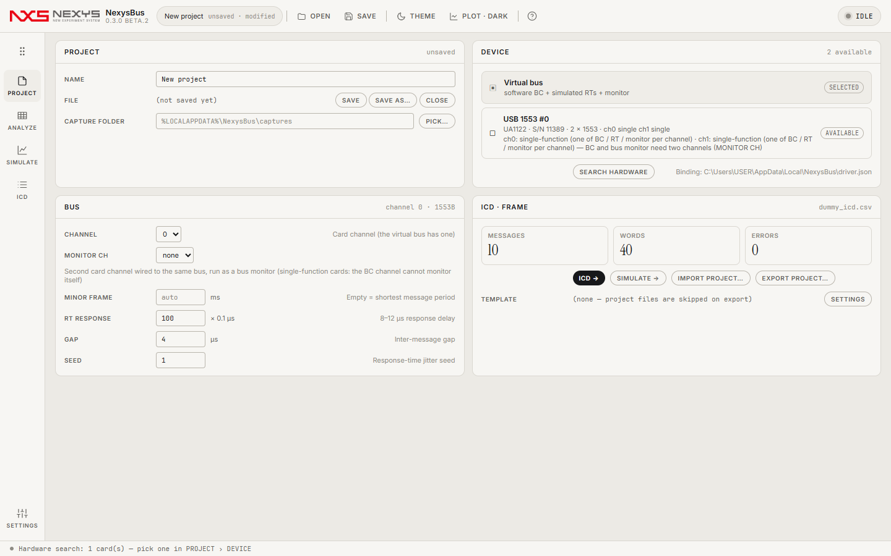

# 2. PROJECT — 장치 · 버스 · 파일

PROJECT는 "무엇으로, 어떤 버스를, 어떤 설정으로" 돌릴지 정하는 화면입니다. 여기서 정한 것은 전부 프로젝트 파일(`.nxb`)에 저장됩니다.

## 2.1 PROJECT 카드
| 항목 | 설명 |
|---|---|
| NAME | 프로젝트 이름. 캡처 파일 이름 앞부분에도 쓰입니다. |
| FILE | SAVE · SAVE AS… · CLOSE. 저장 전에는 `(not saved yet)`. |
| CAPTURE FOLDER | 실행 결과(`.mon`)가 저장되는 곳. 비우면 `%LOCALAPPDATA%\NexysBus\captures`. PICK…으로 바꿉니다. |

## 2.2 DEVICE 카드 — 무엇으로 돌릴지
- **Virtual bus**: 항상 있습니다. 소프트웨어 BC + 시뮬레이트 RT + 모니터. 하드웨어가 없어도 전부 동작하며, 정해진 프레임이면 결과가 항상 같습니다(정답지 만들기에 좋음).
- **카드(예: `USB 1553 #0`)**: 카드 드라이버 연결 파일(`driver.json`)이 있는 PC에서 **SEARCH HARDWARE**를 누르면 나타납니다. 카드 모델·시리얼·1553 채널 수와 **채널마다의 능력**이 함께 표시됩니다.
  - `single-function`: 한 채널이 BC·RT·모니터 중 **하나만** 합니다. BC로 쓰는 채널에서는 RT 흉내도, 자기 트래픽 모니터링도 못 합니다. 그래서 NexysBus는 BC가 보낸 메시지 기록을 카드의 메시지 블록에서 읽고, 전체 버스를 듣고 싶으면 **두 번째 채널을 같은 버스에 연결해 MONITOR CH로 지정**하라고 안내합니다.
  - `multi-function`: 한 채널이 BC + RT + 모니터를 동시에 합니다.
- 카드를 눌러 `SELECTED`로 만들면 SIMULATE의 START가 그 카드로 나갑니다. 자세한 것은 [6장](06-hardware.md).

## 2.3 BUS 카드 — 버스 설정
| 항목 | 설명 | 기본값 |
|---|---|---|
| CHANNEL | 카드의 몇 번 채널을 BC로 쓸지(가상 버스는 무시) | 0 |
| MONITOR CH | 같은 버스에 연결된 두 번째 채널을 버스 모니터로(단일 기능 카드에서 전체 트래픽 기록) | none |
| MINOR FRAME | 마이너 프레임 길이(ms). 비우면 가장 짧은 메시지 주기 | auto |
| RT RESPONSE | 가상 RT의 응답 지연(0.1 µs 단위, 100 = 10 µs) | 100 |
| GAP | 메시지 사이 간격(µs) | 4 |
| SEED | 응답 지연 흔들림(지터)의 난수 시드. 같은 시드 = 같은 결과 | 1 |

## 2.4 ICD · FRAME 카드
현재 프로젝트의 ICD 요약(메시지·워드·오류 수)과 버튼: **ICD →**(ICD 레일), **SIMULATE →**, **IMPORT PROJECT…**(시뮬레이터 프로젝트 파일에서 메시지·필드 읽기), **EXPORT PROJECT…**(템플릿 프로젝트를 복제해 시뮬레이터 프로젝트로 쓰기), TEMPLATE(내보내기에 쓸 템플릿 폴더, SETTINGS에서 지정).

## 2.5 프로젝트 파일(.nxb)
JSON 텍스트 파일이라 비교·버전 관리가 쉽습니다. 장치, 버스 설정, ICD 전체, 프레임(순서·주기·ON), RT 데이터 소스, 오류 주입, 캡처 폴더가 들어 있습니다. 시작 화면의 최근 목록이나 `Ctrl+O`, 파일 끌어다 놓기로 엽니다.

다음: [3. ICD](03-icd.md)
