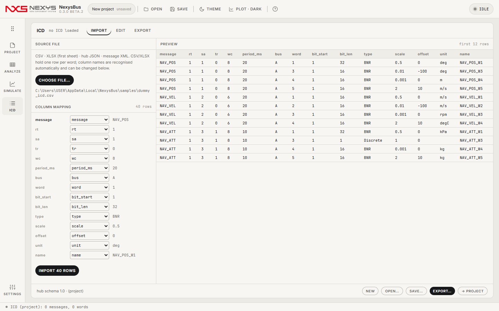
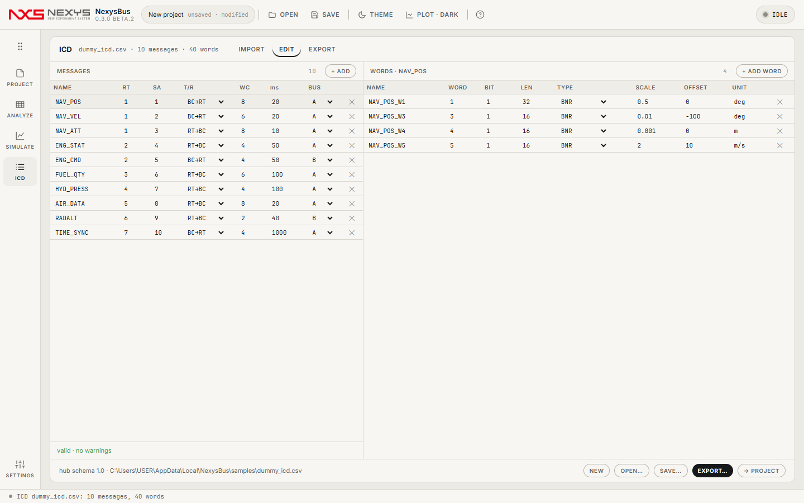
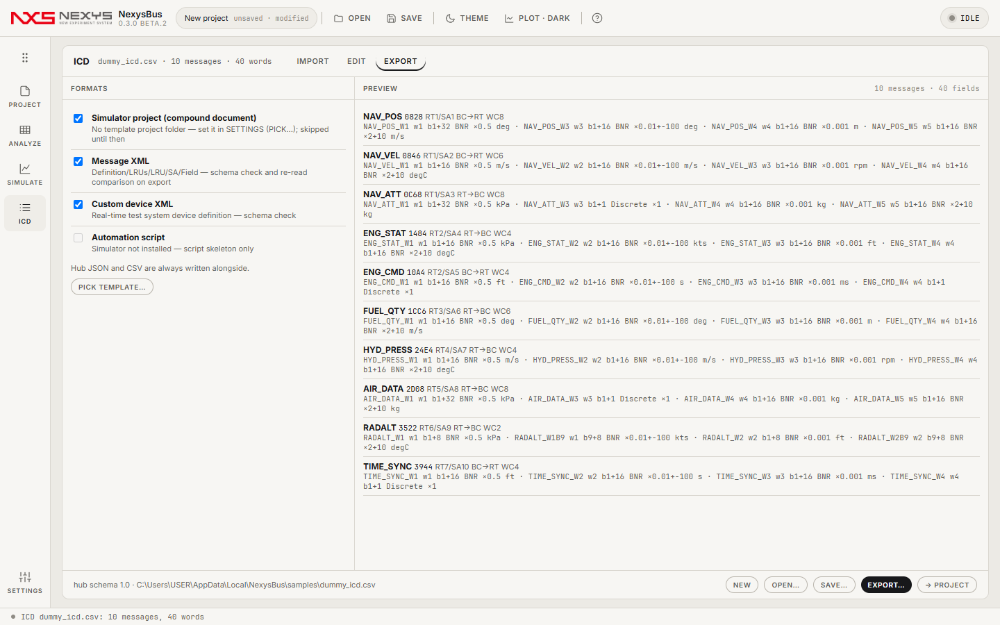

# 3. ICD — 가져오기 · 편집 · 내보내기

ICD(Interface Control Document)는 "어느 RT의 어느 SA에 어떤 워드가 몇 비트로, 어떤 단위로 들어 있는지"의 정의입니다. NexysBus에서는 ICD가 곧 **프레임**(무엇을 언제 보낼지)이고, ANALYZE에서 원시 비트를 **공학값**으로 바꾸는 사전입니다.

## 3.1 IMPORT

| 형식 | 동작 |
|---|---|
| CSV / XLSX(첫 시트) | **워드 하나당 한 줄**. 열 이름을 자동으로 알아보고(아래 표), 못 알아본 열은 COLUMN MAPPING에서 직접 고릅니다. PREVIEW로 확인 후 **IMPORT n ROWS**. |
| 허브 JSON | NexysBus 고유 형식(내보내기 결과). 바로 열립니다. |
| 메시지 XML | 메시지 데이터베이스 XML. 바로 열립니다. |
| 커스텀 디바이스 설정 XML + 파라미터 XML | 1553 장비 설정 파일 쌍(원격 단말·서브어드레스·모드 코드·메시지 버퍼 / 단말·서브어드레스·방향·워드 수). **같은 폴더에 짝 파일이 있으면 자동으로 합칩니다**: 워드 수는 파라미터 파일 우선, 없으면 버퍼 크기. 어느 쪽을 열어도 같은 결과. |

CSV 열(대소문자·공백 무관, 별칭도 인식):

| 열 | 뜻 | 예 |
|---|---|---|
| message | 메시지 이름(같은 이름의 줄은 한 메시지로 묶임) | `NAV_POS` |
| rt, sa | 단말 주소(0–31), 서브어드레스(0–31) | `1`, `1` |
| tr | 0/R/BC→RT = 수신, 1/T/RT→BC = 송신 | `0` |
| wc | 데이터 워드 수(1–32) | `8` |
| period_ms | 주기(ms) | `20` |
| bus | A / B | `A` |
| mode_code | 모드 코드 번호(있으면 SA·WC 대신 이 코드로 명령) | `16` |
| word | 워드 번호(1부터) | `3` |
| bit_start, bit_len | 시작 비트(1 = LSB), 비트 수 | `1`, `16` |
| type | BNR · UINT · BCD · Discrete … | `BNR` |
| scale, offset, unit | EU = 원시 × scale + offset, 단위 | `0.01`, `-100`, `deg` |
| name | 워드(필드) 이름 | `NAV_POS_W3` |

## 3.2 EDIT

왼쪽 메시지 표, 오른쪽 선택한 메시지의 워드 표에서 바로 고치고 추가·삭제합니다. 검증은 자동입니다.
- **error**(내보내기 차단): RT·SA 0–31 밖, WC 1–32 밖, 비트 범위가 워드를 넘거나 겹침, 모드 코드 0–31 밖.
- **warning**: 같은 RT/SA/방향 메시지 중복.
- 하단 푸터에 출처 파일·스키마 버전·NEW·OPEN…·SAVE…(허브 JSON).

## 3.3 EXPORT

체크한 형식을 한 번에 씁니다. 허브 JSON과 CSV는 항상 함께 저장됩니다.
| 형식 | 설명 |
|---|---|
| 시뮬레이터 프로젝트 | SETTINGS의 템플릿 프로젝트(RT/SA 노드가 있는 것)를 복제해 메시지·필드를 채움 |
| 메시지 XML | XSD로 검사하고 다시 읽어 같은지 확인 |
| 커스텀 디바이스 XML | 장비 설정용 XML(XSD 검사) |
| 자동화 스크립트 | 프레임을 구성하는 스크립트 |

## 3.4 팁
- 가져온 ICD는 곧바로 프로젝트의 프레임이 됩니다. 주기·순서·ON은 SIMULATE에서 바꾸고, 메시지 구조는 ICD에서 바꿉니다.
- 워드를 다 정의하지 않아도 됩니다. 정의한 워드만 ANALYZE에서 이름·EU로 보이고, 나머지는 원시 hex로 보입니다.
- 모드 코드 메시지는 `mode_code` 열만 채우면 됩니다(16–31은 데이터 워드 1개가 자동).

다음: [4. SIMULATE](04-simulate.md)
