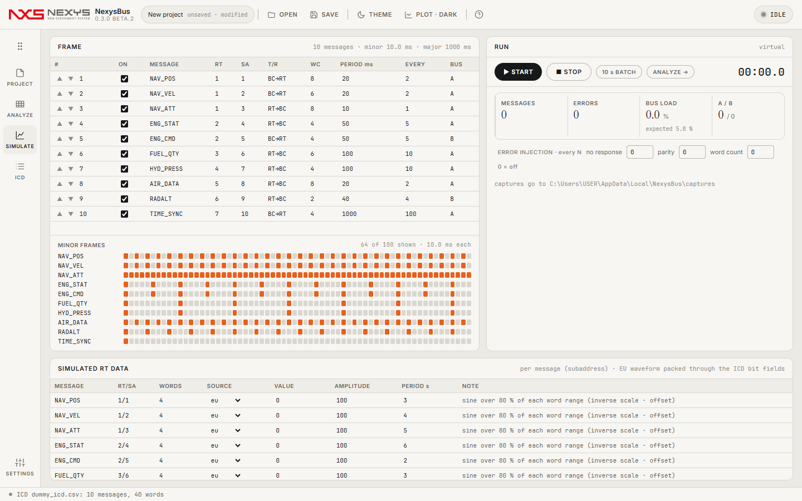
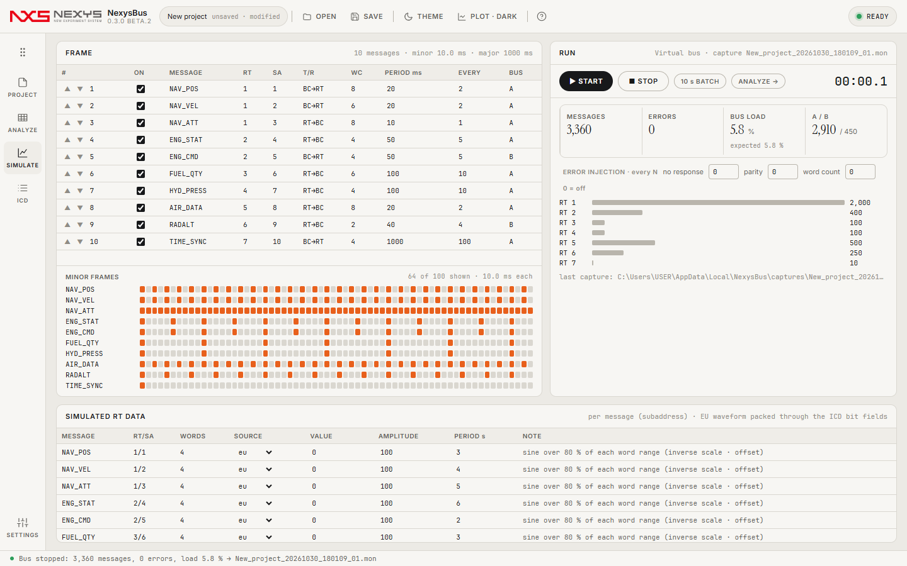

# 4. SIMULATE — 프레임 편집과 실행

## 4.1 FRAME 표
| 열 | 설명 |
|---|---|
| ▲▼ | 마이너 프레임 안에서의 순서 |
| ON | 끄면 프레임에서 빠집니다(ICD에는 남음) |
| MESSAGE · RT · SA · T/R · WC | ICD에서 온 값. 모드 코드는 SA 칸에 `MC16`처럼 표시 |
| PERIOD ms | 주기. 바꾸면 EVERY와 메이저 프레임이 다시 계산됩니다 |
| EVERY | 몇 번째 마이너 프레임마다 나가는지(= 주기 ÷ 마이너) |
| BUS | A / B |

표 아래 **MINOR FRAMES** 격자는 메이저 프레임 안에서 각 메시지가 어느 칸에 들어가는지 보여 줍니다. 한 칸에 몰리면 버스 로드가 순간적으로 높아집니다.

## 4.2 SIMULATED RT DATA
메시지(서브어드레스)마다 데이터가 시간에 따라 어떻게 바뀌는지 정합니다. 가상 버스에서는 RT가 보내는 데이터, BC→RT 메시지에서는 BC가 보내는 데이터입니다.

| SOURCE | 동작 |
|---|---|
| eu | 각 워드 범위의 80 %를 오가는 사인파를 ICD scale·offset으로 역변환해 넣음(기본) |
| sine | VALUE ± AMPLITUDE, PERIOD s 주기 사인 |
| ramp | VALUE에서 VALUE + AMPLITUDE까지 PERIOD s마다 반복 |
| const | VALUE 고정 |

정상이라면 ANALYZE의 디코드 EU가 여기 입력한 파형과 같습니다(차이는 양자화 scale/2 이하).

## 4.3 RUN

| 버튼·표시 | 설명 |
|---|---|
| ▶ START / ■ STOP | 실시간 실행. 실행 중 ANALYZE 목록이 계속 늘어나고, STOP하면 `.mon`으로 저장 |
| 10 s BATCH | 가상 시계로 10초 분량을 즉시 생성(가상 버스 전용). 메시지 수가 정확히 Σ⌈10 s ÷ 주기⌉ |
| ANALYZE → | 방금 캡처로 이동 |
| MESSAGES · ERRORS · BUS LOAD · A/B | 실행 카운터. BUS LOAD는 (명령어 + 상태어 + 데이터) × 20 µs 근사, 그 아래 `expected`는 프레임 표만으로 계산한 기대값 |
| RT별 막대 | RT마다 메시지 수 |
| ERROR INJECTION | N번째 메시지마다 무응답(no response)·패리티·워드 수 오류를 넣음(0 = 끔, 가상 버스 전용) |
| 경과 시간 | 실행 시간(우상단) |

하드웨어 카드로 실행하면 상태줄에 `(BC message blocks)`와 `n not read`(메시지 블록 방식에서 놓친 트랜잭션 수)가 함께 나옵니다([6장](06-hardware.md)).

## 4.4 이렇게 쓰세요
- **정답지 만들기**: 10 s BATCH는 결과가 항상 같습니다. 다른 도구의 분석 결과와 비교할 기준 캡처로 쓰기 좋습니다.
- **오류 처리 시험**: ERROR INJECTION으로 무응답 50번째마다 → ANALYZE에서 ERRORS ONLY 필터로 개수가 같은지 확인.
- **부하 점검**: 주기를 바꿔 가며 `expected` 버스 로드를 보고, 격자에서 한 마이너 프레임에 메시지가 몰리지 않는지 봅니다.

다음: [5. ANALYZE](05-analyze.md)
