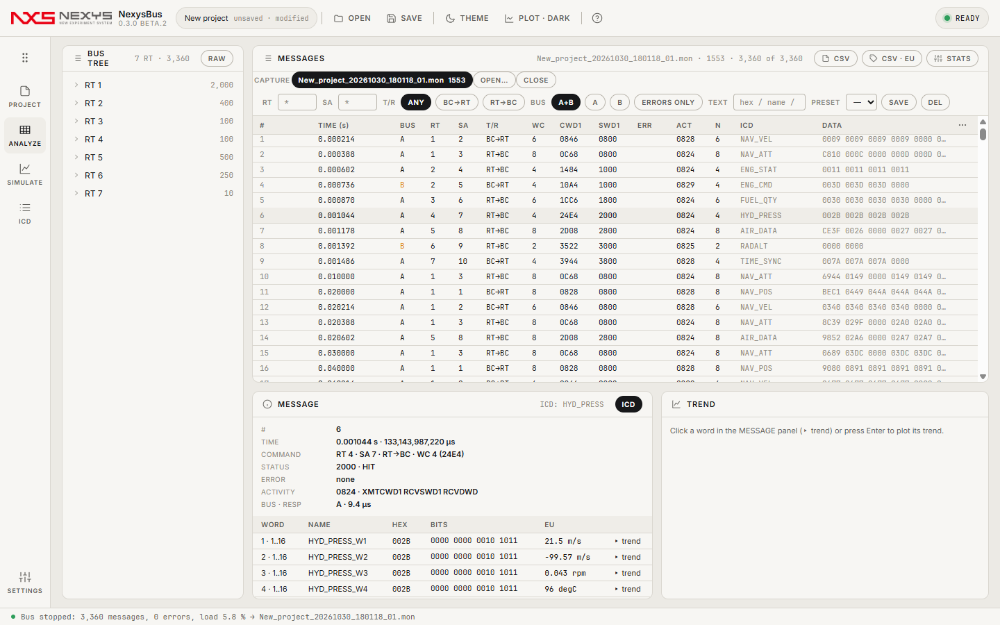
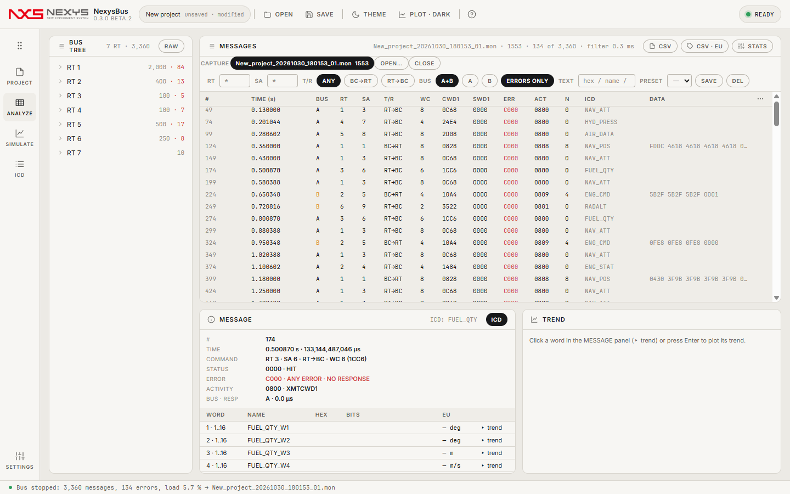
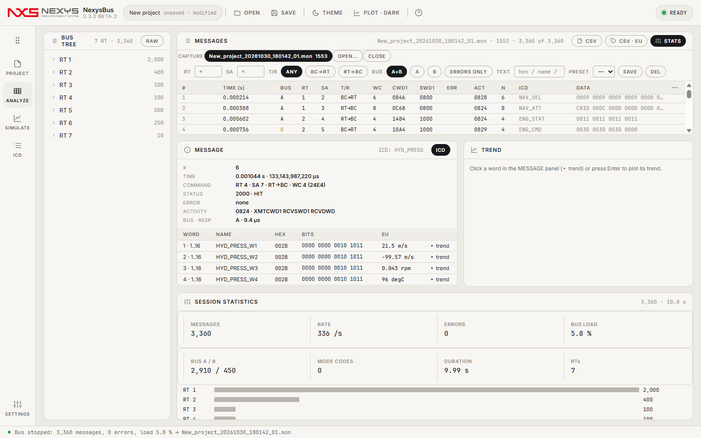

# 5. ANALYZE — 캡처 분석

## 5.1 화면 구성
| 영역 | 설명 |
|---|---|
| BUS TREE(왼쪽) | RT → SA(T/R) → ICD 워드. 노드마다 메시지·오류 수. 누르면 그 노드로 필터. RAW 토글은 채널 목록 |
| CAPTURE 칩 | 열려 있는 캡처(실행 중인 것 포함). OPEN…으로 저장된 `.mon` 추가, CLOSE |
| 필터 바 | RT · SA · T/R(ANY/BC→RT/RT→BC) · BUS(A+B/A/B) · ERRORS ONLY · TEXT · PRESET(SAVE/DEL) |
| MESSAGES 목록 | 100만 건도 그대로 스크롤. 머리글 클릭 = 정렬, ⋯ 메뉴 = 시간 표시·열 선택 |
| MESSAGE(디코드) | 선택 행의 시간·명령어·상태어·오류·활동 비트·버스·응답 시간 + 워드 표(hex · 4비트 묶음 비트 · EU) |
| TREND | 워드 하나의 시간 추이(LAST 10 s / 60 s / ALL, SEND TO VIEW) |
| 헤더 버튼 | CSV(현재 목록) · CSV·EU(ICD 디코드 값) · STATS |

## 5.2 목록 열
`#` · TIME · BUS · RT · SA · T/R · WC · CWD1(명령어 hex) · SWD1(상태어) · ERR(오류 비트) · ACT(활동 비트) · N(데이터 워드 수) · ICD(메시지 이름) · DATA. 숨겨진 열(STAT 등)은 ⋯ › COLUMNS에서 켭니다.

시간 표시(⋯ 메뉴): **REL**(캡처 시작부터 초) · **ABS**(카드 타임태그 µs) · **Δ**(바로 앞 행과의 간격).

## 5.3 필터
- 조합 예: `RT 4` + `SA 4` + `RT→BC` → 그 메시지만. TEXT에는 hex(`8000`), ICD 이름(`SA4_TIME`), `RT3` 같은 것을 넣습니다.
- **ERRORS ONLY**: 오류 비트가 하나라도 선 레코드만(무응답·패리티·워드 수·동기 등). HIT(정상 처리 표시)는 오류가 아닙니다.
- **PRESET**: 지금 필터 조합을 이름 붙여 저장.

## 5.4 디코드·추이
행을 고르면 아래 MESSAGE 카드에 명령어(`RT 4 · SA 4 · RT→BC · WC 30`), 상태어(`2000`), 오류 이름, 활동 비트(`XMTCWD1 RCVSWD1 RCVDWD BUS B`), 버스·응답 시간이 나오고, ICD가 있으면 워드마다 이름·hex·비트·EU가 나옵니다. 워드 줄의 `▸ trend`(또는 Enter)로 그 워드의 추이 그래프를 엽니다.

## 5.5 통계(STATS)
메시지 수·지속 시간·초당 메시지·RT별 분포·오류 수·버스 B 비율·모드 코드 수·버스 로드.

## 5.6 키보드
| 동작 | 키 |
|---|---|
| 행 이동 | ↑ ↓ · PgUp PgDn · Home End |
| 첫 ICD 워드 추이 | Enter |
| 선택 행 복사 | Ctrl + C |

ARINC 429 캡처도 같은 화면에서 열립니다(LABEL 옥탈 · SDI · SSM · 패리티 필터).

다음: [6. 하드웨어 카드](06-hardware.md)
