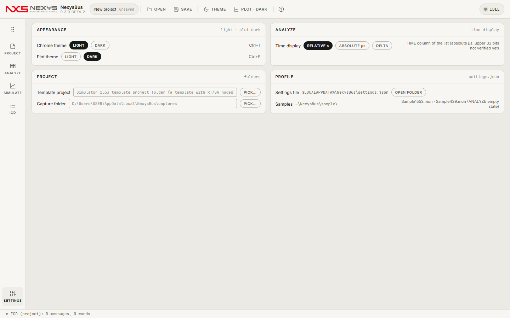
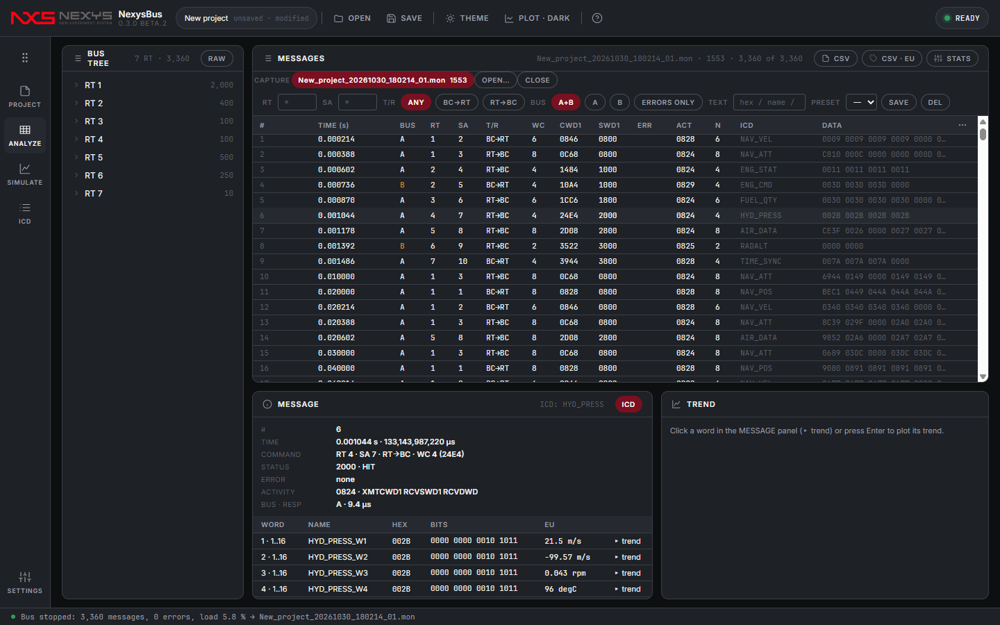
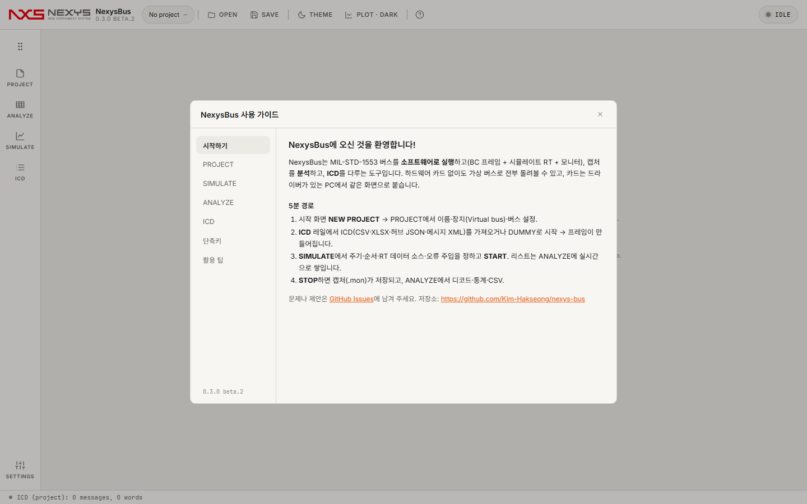

# 8. 파일 · 설정 · 단축키 · 문제 해결

## 8.1 파일
| 파일 | 형식 | 내용 |
|---|---|---|
| `.nxb` | JSON | 프로젝트: device · bus(channel, monitorChannel, minorFrameMs, responseTenthUs, gapUs, seed) · icd · schedule · sources · errors · captureDir |
| `.mon` | 바이너리(복합문서 메타 + 120바이트 레코드) | 1553 캡처. 레코드 = 타임태그(µs, 상위 32비트 포함) · 활동 · 오류 · 명령어 1/2 · 상태어 1/2 · 데이터 수 · 데이터 최대 40 · 응답 시간 |
| 허브 JSON | JSON(스키마 1.0) | ICD 전체(메시지 → 워드). 내보내기 기본 형식 |
| ICD CSV | 텍스트 | 워드당 한 줄([3장 열 표](03-icd.md#31-import)) |
| `driver.json` | JSON | 카드 드라이버 연결([6장](06-hardware.md)) |
| `settings.json` | JSON | `%LOCALAPPDATA%\NexysBus\settings.json`: 테마·플롯·시간 표시·템플릿·캡처 폴더·최근 목록 |

## 8.2 SETTINGS

| 카드 | 항목 |
|---|---|
| APPEARANCE | 테마(밝게/어둡게, Ctrl+T), 플롯 밝기(Ctrl+P) |
| ANALYZE | 목록 TIME 열 표시(REL / ABS µs / Δ), 예제 캡처(빈 화면에서 열 수 있는 샘플) |
| PROJECT | 템플릿 프로젝트 폴더(시뮬레이터 프로젝트 내보내기용), 캡처 폴더 |
| PROFILE | 설정 파일 위치와 OPEN FOLDER |

어두운 테마:

## 8.3 키보드
| 동작 | 키 |
|---|---|
| PROJECT / ANALYZE / SIMULATE / ICD / SETTINGS | Ctrl + 1 · 2 · 3 · 4 · 5 |
| 열기(프로젝트 · 캡처 · ICD) | Ctrl + O |
| 프로젝트 저장 | Ctrl + S |
| 테마 / 플롯 밝기 | Ctrl + T / Ctrl + P |
| 도움말 / 닫기 | F1 / Esc |
| 목록 이동 · 추이 · 복사 | ↑↓ PgUp PgDn Home End · Enter · Ctrl + C |

파일(`.nxb` · `.mon` · 시뮬레이터 프로젝트 · ICD)은 창 어디에나 끌어다 놓으면 알맞은 화면으로 열립니다.

## 8.4 자주 묻는 것
| 질문 | 답 |
|---|---|
| 하드웨어가 없는데 쓸 수 있나요? | 네. 가상 버스로 프레임 실행·오류 주입·분석·ICD 전부 됩니다. |
| BATCH와 START는 뭐가 다른가요? | BATCH는 가상 시계로 즉시 10초 분량을 만듭니다(결과가 항상 같음). START는 실제 시간으로 돌고, 카드에서도 동작합니다. |
| 버스 로드가 `expected`와 조금 달라요 | 실행 값은 실제 캡처의 워드 수로, expected는 프레임 표로 계산합니다. 무응답 메시지는 데이터가 없어 실행 값이 낮아집니다. |
| 디코드 EU가 입력과 다릅니다 | ICD의 scale·offset·bit_start(1 = LSB)·bit_len을 확인하세요. 차이가 scale/2 이하면 양자화 오차입니다. |
| 카드에서 응답이 하나도 없어요 | 상대 RT가 그 버스(A/B)에 실제로 연결돼 있는지 확인하세요. [6.5](06-hardware.md#65-문제가-생기면) |
| 캡처는 어디에 저장되나요? | PROJECT의 CAPTURE FOLDER(기본 `%LOCALAPPDATA%\NexysBus\captures`), 파일 이름 = 프로젝트 이름_날짜_시각_번호.mon |
| 문제를 알리려면? | [GitHub Issues](https://github.com/Kim-Hakseong/nexys-bus/issues)에 상태줄 문구와 `%LOCALAPPDATA%\NexysBus` 폴더의 로그를 첨부해 주세요. |

[가이드 처음으로](README.md)
