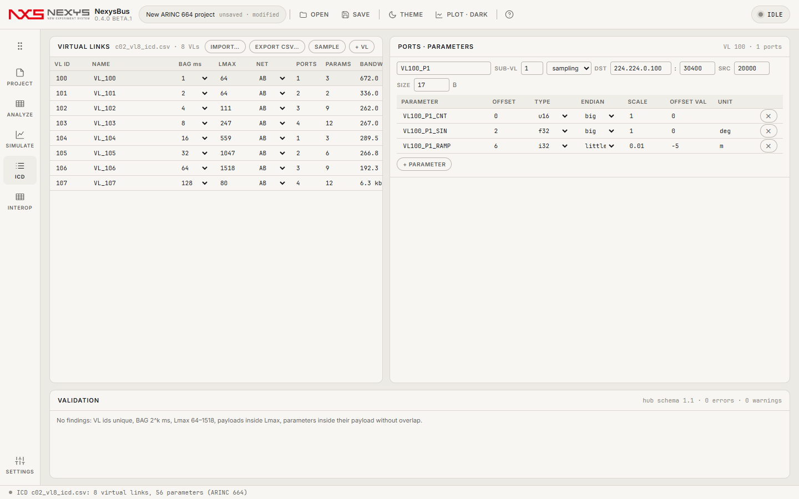
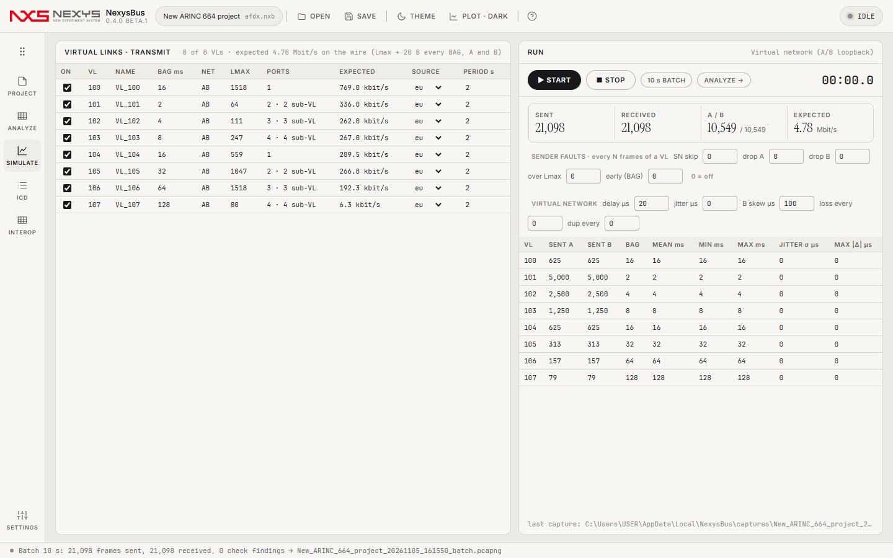
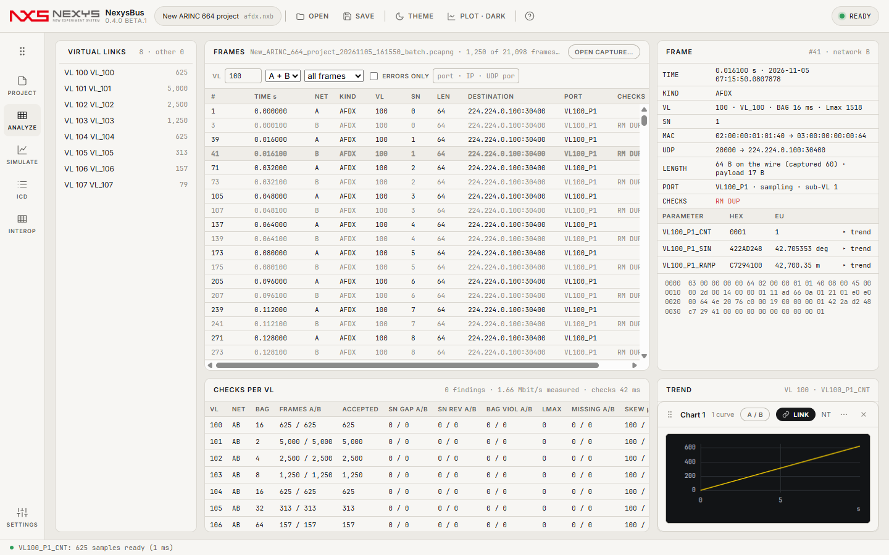
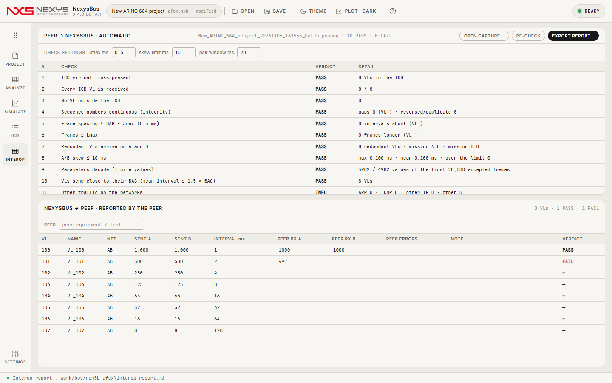
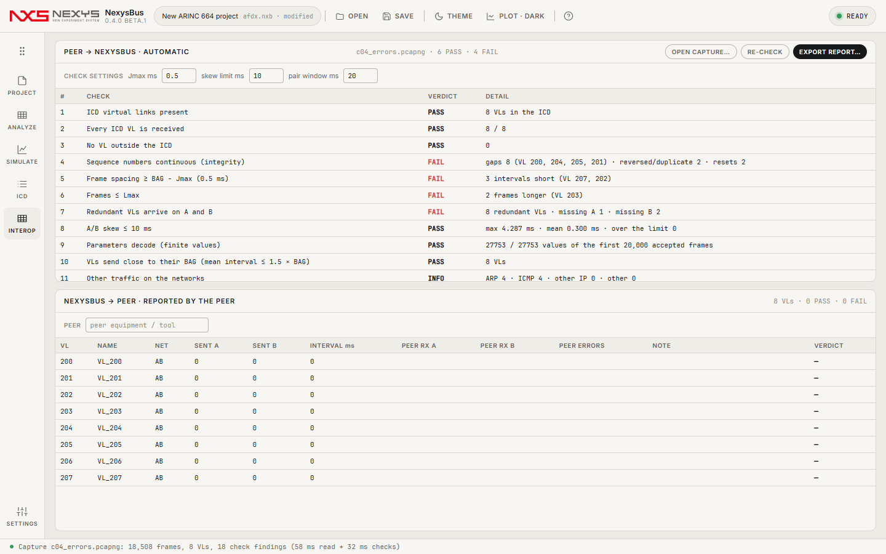

# 9. ARINC 664 (AFDX)

NexysBus 0.4.0부터 ARINC 664 Part 7(AFDX) 네트워크를 다룹니다. Wireshark로 하던 "보냈나·받았나·순서·간격·이중화" 확인을 한 화면에서 합니다: **캡처**(pcapng) → **디코드**(VL · SN · A/B · ICD 파라미터 EU) → **검사**(SN 무결성 · BAG · Lmax · 이중화/스큐) → **송신 시뮬레이션** → **상호운용 체크리스트·보고서**.

## 9.1 프로젝트 만들기

- 시작 화면 **NEW ARINC 664 PROJECT**, 또는 기존 프로젝트의 PROJECT › **PROTOCOL**을 `ARINC 664 (AFDX)`로 바꿉니다.
- `.pcapng`/`.pcap`을 열거나 끌어다 놓으면 자동으로 664 프로젝트가 되고 ANALYZE에 열립니다.
- 664 프로젝트에서는 ICD · SIMULATE · ANALYZE 레일이 664 화면으로 바뀌고 **INTEROP** 레일(Ctrl+6)이 생깁니다. 1553 프로젝트에서는 664 코드가 아예 실행되지 않습니다(시작 메모리 변화 없음).

**장치**(PROJECT › DEVICE)

| 장치 | 언제 | 비고 |
|---|---|---|
| Virtual network | 항상 | A/B 루프백. SIMULATE의 VIRTUAL NETWORK 칸으로 지연 · 지터 · B 스큐 · N번째마다 손실 · 중복을 넣습니다 |
| Ethernet ports (A / B) | 패킷 캡처 라이브러리(Npcap)가 설치된 PC | NexysBus에 들어 있지 않으며 따로 설치합니다. PROJECT › NETWORK A / B에서 포트를 고릅니다. 같은 포트를 둘 다 고르면 출발지 MAC의 인터페이스 id로 A/B를 나눕니다 |
| AFDX end-system card | — | 전용 카드 어댑터 자리만 있습니다(이번 버전에서는 사용할 수 없음) |

## 9.2 ICD (허브 스키마 1.1)



VL → 포트 → 파라미터 3단입니다.

- **VL**: `vl_id`(0…65535), `name`, `bag_ms`(1·2·4·…·128), `lmax`(64…1518 B, FCS 포함), `network`(A · B · AB). BANDWIDTH = (Lmax + 20) × 8 / BAG.
- **포트**: `sub_vl`(1…4), `port_type`(sampling · queuing), `ip_src`, `ip_dst`, `udp_src`, `udp_dst`, `size`(UDP 페이로드 1…1471 B, 17 B 미만은 선로에서 17 B로 패딩).
- **파라미터**: `offset`(페이로드 안 바이트 위치), `type`(u8 i8 u16 i16 u32 i32 u64 i64 f32 f64), `endian`(big · little), `scale`, `offset_val`, `unit`. EU = raw × scale + offset_val.

**IMPORT…**: CSV · XLSX(첫 시트)는 파라미터당 1행이고 열 이름을 자동으로 알아봅니다(`vl_id`·`vl`, `bag_ms`·`bag`, `udp_dst`·`dst_port`, `param`·`name` …). 허브 JSON(`vls` 포함)도 됩니다. **EXPORT CSV…**, **SAMPLE**(6 VL 예제), **+ VL**, 포트별 **+ PARAMETER**.

**VALIDATION**: error(내보내기·실행 전 고칠 것) — VL id 중복 · BAG가 2^k 아님 · Lmax 범위 · 페이로드가 Lmax를 넘음 · 파라미터가 페이로드 밖 · 바이트 겹침 · 모르는 type. warning — 같은 목적지 IP:포트 중복, sub-VL 1…4 밖.

## 9.3 SIMULATE — 송신



- **VIRTUAL LINKS · TRANSMIT**: ON(이 VL을 보낼지), 데이터 소스(eu = 각 파라미터 범위의 80 % 사인, sine · ramp · const), PERIOD s. `_CNT`로 끝나는 파라미터는 프레임 카운터(0, 1, 2…)입니다.
- 송신 규칙: VL마다 BAG마다 한 프레임, 포트는 차례대로, 이중화(AB) VL은 A·B 동시, SN 자동(시작 0, 이후 1…255 순환).
- **START / STOP**: 실시간(전용 스레드, 1 ms 타이머 + 마지막 1.5 ms 바쁜 대기). 받은 프레임이 ANALYZE에 쌓이고 STOP하면 `.pcapng`로 저장됩니다. **10 s BATCH**: 가상 시계로 10초치를 즉시 만듭니다(간격이 BAG과 정확히 같음 — 정답지용).
- RUN 표: SENT A/B, 실제 송신 간격 MEAN/MIN/MAX, JITTER σ(예정 시각 대비), MAX |Δ|. 스레드가 늦게 깨어나 예정보다 0.25 ms 넘게 늦으면 몰아서 보내지 않고 일정을 뒤로 밉니다(그래야 선로에서 BAG − Jmax보다 좁은 간격이 생기지 않습니다).
- **SENDER FAULTS**(VL의 N번째 정규 프레임마다): SN skip · drop A · drop B · over Lmax · early(0.1 ms 뒤 한 프레임 더 = BAG 위반). **VIRTUAL NETWORK**: delay · jitter · B skew(µs) · loss every · dup every.

## 9.4 ANALYZE — 캡처와 검사



- **VIRTUAL LINKS**(왼쪽): VL별 채택 프레임 수와 검사 건수. VL을 누르면 그 VL만 보이고, 펼치면 ICD 파라미터(▸ 추이).
- **FRAMES**: 100만 프레임도 바로 스크롤(가상 목록). 열: #, TIME s, NET, KIND(AFDX · ARP · ICMP · OTHERIP · OTHER), VL, SN, LEN(와이어, FCS 포함), DESTINATION, PORT, CHECKS(SN GAP · SN REV · SN RESET · BAG · LMAX · RM DUP · NOT IN ICD). 흐린 행 = 다른 네트워크의 중복 사본. 필터: VL · A/B · 종류 · ERRORS ONLY · 텍스트(포트 이름 · IP · UDP 포트).
- **FRAME**: 시각(상대 · 절대), VL/BAG/Lmax, SN, MAC, UDP, 길이, 포트, 검사, ICD 파라미터(HEX · EU · ▸ trend), 16진 덤프.
- **CHECKS PER VL**: 네트워크별 프레임, 채택 수, SN GAP/REV, BAG 위반, Lmax 위반, 누락 A/B, 스큐 평균/최대, 평균 간격, 지터, 측정 대역폭. 행을 누르면 그 VL로 필터. BAG에 `*`이 붙으면 ICD에 없는 VL이라 캡처에서 추정한 값입니다.
- **TREND**: 파라미터 EU의 시간 추이(1553과 같은 차트 엔진).

### 검사 규칙

| 검사 | 규칙 |
|---|---|
| SN 무결성 | VL · 네트워크별. 0 = 리셋. 다음 기대값 = 이전 + 1(255 다음은 1). 1…127 앞서면 그만큼 손실(GAP), 그 외는 역순·중복(REV, 폐기) |
| BAG | 같은 네트워크의 연속 프레임 간격 < BAG − Jmax(기본 0.5 ms) |
| Lmax | 와이어 길이(캡처 + FCS 4 B) > Lmax |
| 이중화(RM) | 같은 VL · SN의 A/B 사본 중 먼저 온 유효 프레임 채택, 다른 쪽은 중복이며 그 시간차가 스큐. 짝이 20 ms 안에 안 오면 그 네트워크 누락 |

네트워크(A/B) 판정 순서: ① 캡처 인터페이스를 직접 지정한 경우 그 값 ② 출발지 MAC 마지막 바이트 상위 3비트(1 = A, 2 = B) ③ 인터페이스 이름·설명이 A/B로 끝나는지 ④ 인터페이스 순서(0 = A, 1 = B). Wireshark/dumpcap으로 두 NIC를 함께 잡은 pcapng(`-i A -i B`)를 그대로 열면 됩니다.

## 9.5 INTEROP — 상호운용 체크리스트



**PEER → NEXYSBUS · AUTOMATIC**: 상대 장비 트래픽 캡처(열기 또는 START 중 수신)를 ICD와 대조해 자동 판정합니다 — ICD VL 존재 · 모든 ICD VL 수신 · ICD 밖 VL 없음 · SN 연속 · BAG − Jmax 이상 간격 · Lmax 이하 · 이중화 VL이 A·B 둘 다 · 스큐 한계 · 파라미터 디코드(유한값) · BAG 대비 송신 빈도(INFO) · 기타 트래픽(INFO). CHECK SETTINGS에서 Jmax · 스큐 한계 · 짝 창을 바꾸면 다시 판정합니다.

**NEXYSBUS → PEER · REPORTED BY THE PEER**: 마지막 실행에서 보낸 VL별 프레임 수 옆에, 상대가 보고한 수신 수(A/B)와 오류 수를 적으면 PASS/FAIL(받은 수 ≥ 보낸 수, 오류 0).

**EXPORT REPORT…** → `interop-report.md`: 날짜 · 도구 버전 · 상대 이름 · ICD · 캡처 · 설정, 자동 판정표, VL별 표, 상대 보고표, 그리고 상대와 실측으로만 확정할 수 있는 항목(IP 주소 체계, 큐잉 포트 분할·재조립, 서브 VL 송신 순서, 상대의 스큐 한계·무결성 모드, 출발지 MAC 인터페이스 id).



## 9.6 현장(사이트 프로필)

`--site --profile <file>`에 `afdx` 절을 넣으면 N0(라이브러리·포트) → N1(수신만 `listenSeconds`) → N2(`txVls`가 있을 때만 송신) 순서로 돌고 `interop-report.md`까지 씁니다. 필드는 [docs/site-profile.md](../site-profile.md)의 "ARINC 664 bench", 예제는 `site-profiles/example-afdx.json`.

## 9.7 자동 검증(`--afdx`)

```
NexysBus.exe --afdx --out <dir> [--corpus <truth corpus dir>] [--frames 1000000] [--rtseconds 5]
```
새 664 프로젝트 → ICD 가져오기 → VL 편집·검증 → 가상 송신(BATCH) → ANALYZE(목록 · 필터 · 디코드 · 추이) → 송신기 오류 주입 검출 → INTEROP(판정 · 상대 표 · 보고서) → 정답지 코퍼스 → 1,000 VL-초 손실 0 → 실시간 1 ms BAG 정확도 → 100만 프레임 성능. 1553 프로젝트에서 664 쪽이 생성되지 않는지도 봅니다.

## 9.8 알려진 한계
- 큐잉 포트의 다중 프레임 메시지(IP 단편화) 재조립, 서브 VL 송신 순서, 상대 장비의 IP 주소 체계는 아직 다루지 않습니다(상호운용 실측 항목).
- 실제 NIC 경로는 Npcap이 있는 PC에서만 동작하며, 개발 PC에는 Npcap이 없어 그 경로는 아직 실측 전입니다.
- Windows 일반 스레드로 보내므로 1 ms BAG의 간격 편차는 p99 0.25 ms 수준이고, 드물게 스레드가 2 ms 넘게 늦게 깨어날 때가 있습니다. 그때는 일정을 미뤄 BAG 위반은 내지 않지만, 그 순간 간격이 길어집니다.
