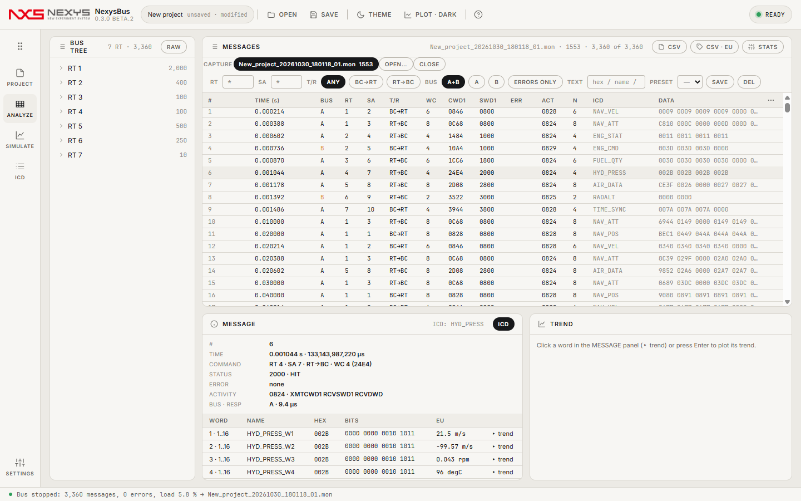

# NexysBus 사용 가이드

NexysBus는 MIL-STD-1553 버스를 **소프트웨어로 돌리고**(BC 프레임 + 시뮬레이트 RT + 모니터), 캡처를 **분석**하고, **ICD**를 다루는 Windows 프로그램입니다. 0.4.0부터 **ARINC 664(AFDX)** 캡처·검사·송신·상호운용 확인도 합니다(9장). 하드웨어 카드 없이 가상 버스로 전부 해 볼 수 있고, 카드가 있는 PC에서는 같은 화면·같은 프레임으로 실제 버스에 붙습니다.

이 가이드는 처음 쓰는 사람이 순서대로 읽도록 짰습니다. 화면 그림은 0.3.0 beta.2에서 가상 버스로 찍은 것입니다.

| 장 | 내용 | 이럴 때 |
|---|---|---|
| [1. 시작하기](01-getting-started.md) | 설치, 첫 실행, 화면 구성, 5분 따라 하기 | 처음 켰을 때 |
| [2. PROJECT](02-project.md) | 프로젝트 파일, 장치 선택, 버스 설정, 채널 능력 | 무엇으로 어떤 버스를 돌릴지 정할 때 |
| [3. ICD](03-icd.md) | 가져오기(CSV·XLSX·JSON·XML·장치 설정 XML), 편집·검증, 내보내기 | 메시지·워드 정의를 만들거나 옮길 때 |
| [4. SIMULATE](04-simulate.md) | 프레임 표, 주기와 마이너/메이저 프레임, RT 데이터 소스, 실행·BATCH, 오류 주입 | 버스를 돌릴 때 |
| [5. ANALYZE](05-analyze.md) | 캡처 목록, 필터·프리셋, 디코드, 추이, 통계, CSV | 결과를 볼 때 |
| [6. 하드웨어 카드](06-hardware.md) | driver.json, SEARCH HARDWARE, 단일/다중 기능 채널, 실측 결과 | 실제 카드로 붙일 때 |
| [7. 자동화·현장 측정](07-automation.md) | 명령줄 셀프테스트, 사이트 프로필, 현장 절차 | 반복 검증·현장 측정 |
| [8. 파일·단축키·문제 해결](08-reference.md) | 파일 형식, 키보드, 자주 묻는 것 | 막혔을 때 |
| [9. ARINC 664 (AFDX)](09-arinc664.md) | 664 프로젝트, VL·포트·파라미터 ICD, 송신, 캡처 검사(SN·BAG·Lmax·이중화), 상호운용 보고서 | Wireshark로 하던 AFDX 송수신 확인을 할 때 |

앱 안에서도 **F1**(또는 상단 `?`)로 요약 도움말을 볼 수 있습니다.

