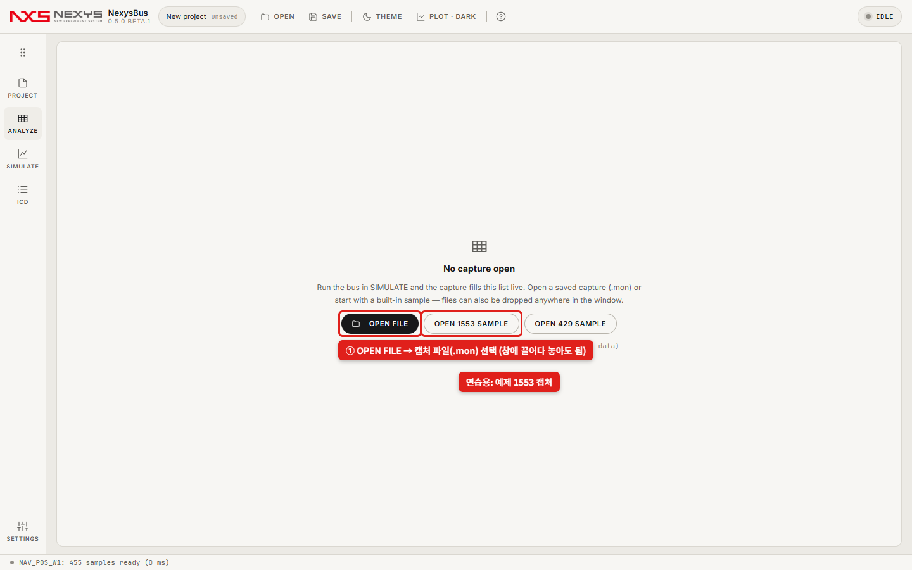
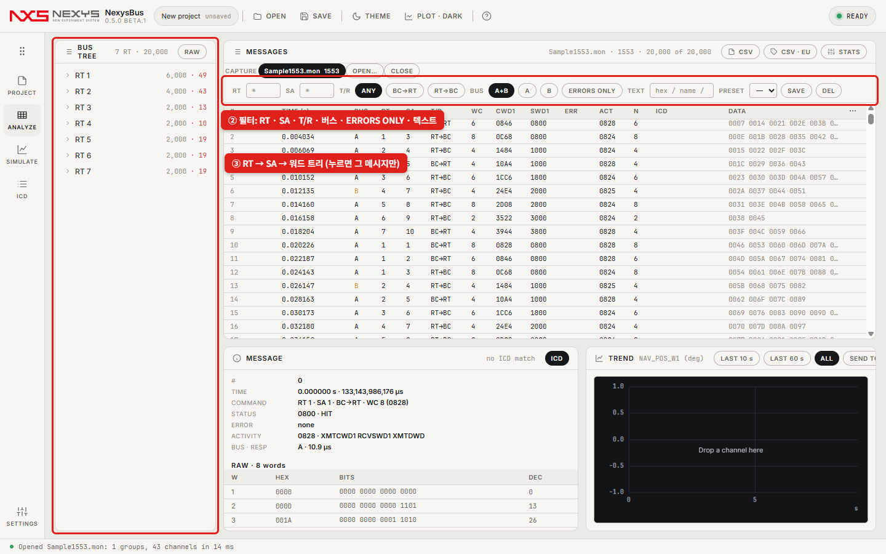
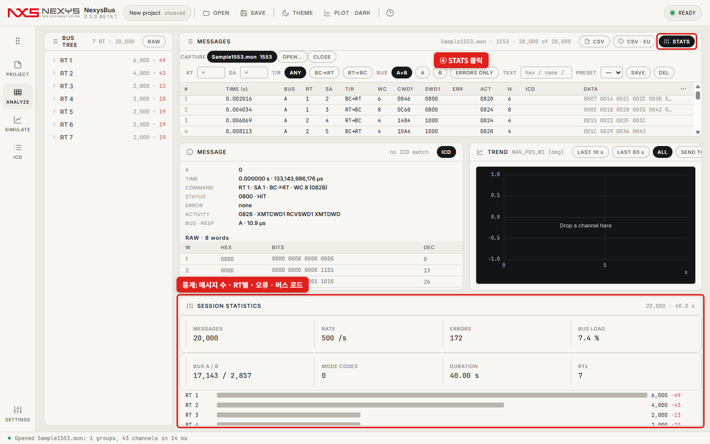

# 캡처 파일 열어 보기 (빠른 시작)

**이런 경우에 씁니다**: 누군가 보내 준 1553 캡처 파일(`.mon`)이나, NexysBus가 실행할 때 저장한 캡처를 열어서 메시지 · 오류 · 통계를 보고 싶을 때. 설치할 것 없음.

---

**① 왼쪽 레일 ANALYZE → OPEN FILE → 캡처 파일(.mon) 선택**(창에 끌어다 놓아도 됩니다). 파일이 없으면 **OPEN 1553 SAMPLE**로 연습하세요.

**② 위쪽 필터: RT · SA · T/R · 버스 · ERRORS ONLY · 텍스트**(16진수나 ICD 이름) · **③ 왼쪽 트리 RT → SA → 워드**(누르면 그 메시지만)

**④ STATS — 메시지 수 · 초당 개수 · 오류 · 버스 로드 · RT별 분포** · 아래 MESSAGE에서 선택한 메시지 디코드

---

## 값(공학값)까지 보려면
캡처만 열면 원시 워드(HEX · 비트)까지 보입니다. **ICD를 가져오면**(ICD 레일 → CHOOSE FILE… → IMPORT, [카드 없이 버스 돌려 보기 ③④](quick-virtual.md)) 워드 이름과 공학값(EU)이 함께 보이고 ▸ trend로 그래프를 그립니다.

## 더 해 볼 것

| 하고 싶은 것 | 어디서 |
|---|---|
| 목록을 CSV로 | 위쪽 **CSV**(원시) · **CSV · EU**(공학값) |
| 시간 표시 바꾸기(상대 초 · 절대 µs · 간격) | 목록 머리글 오른쪽 `⋯` 메뉴 |
| 자주 쓰는 필터 저장 | 필터 줄 **PRESET** → SAVE |
| ARINC 429 캡처 | 같은 방법으로 열림(필터는 LABEL · SDI · SSM · 패리티) — 연습: OPEN 429 SAMPLE |

더 자세한 설명은 [5. ANALYZE](05-analyze.md).
