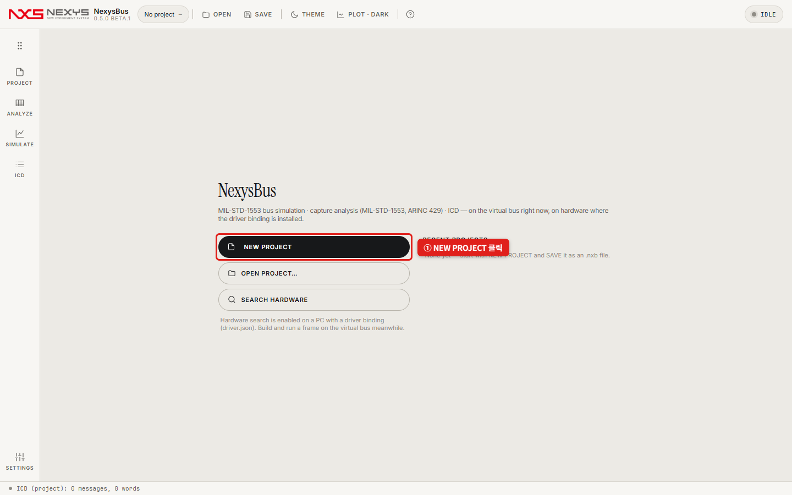
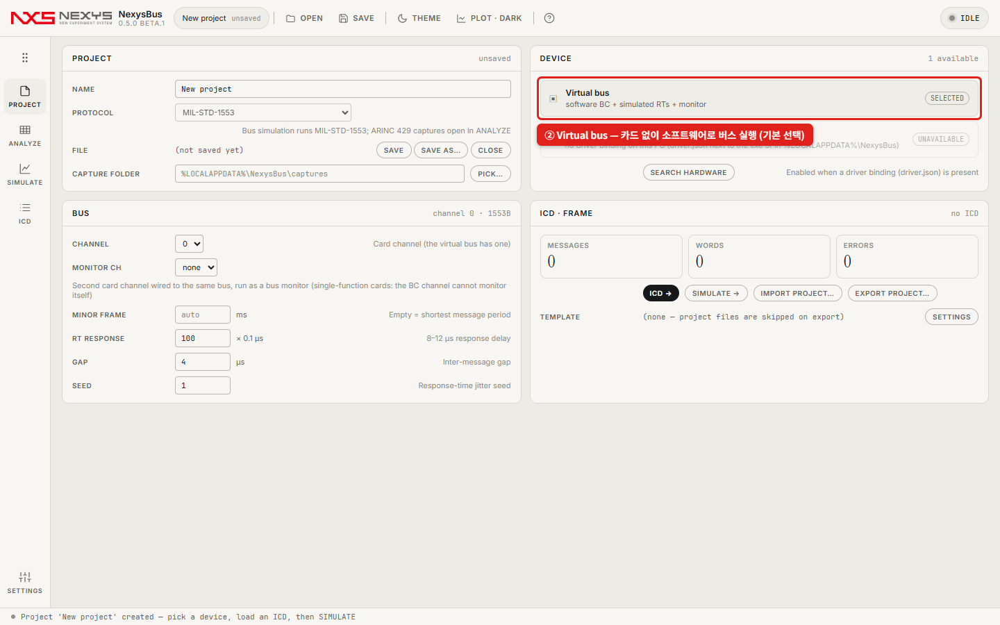
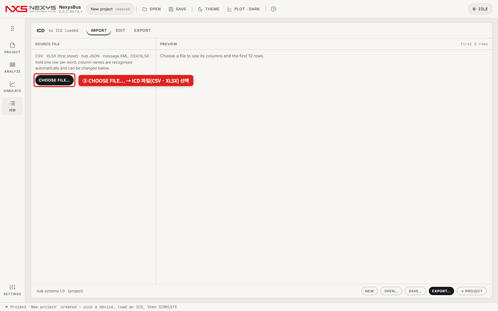
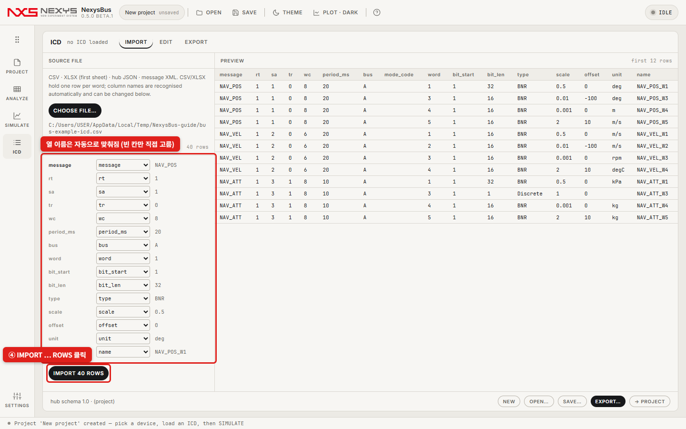
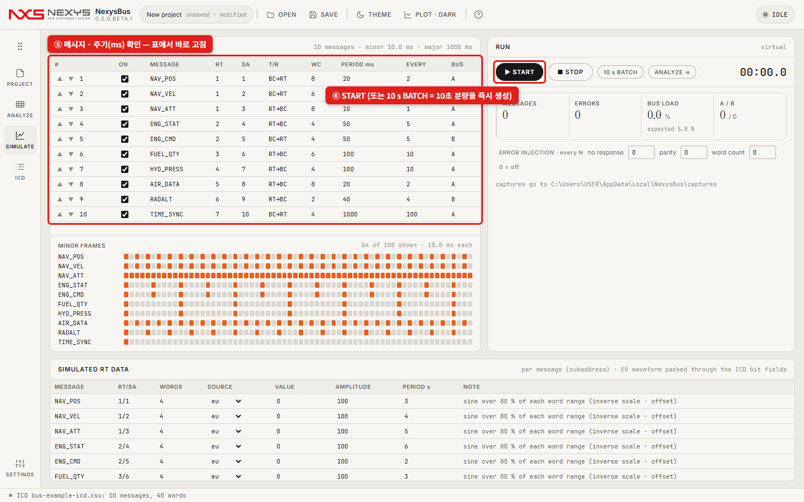
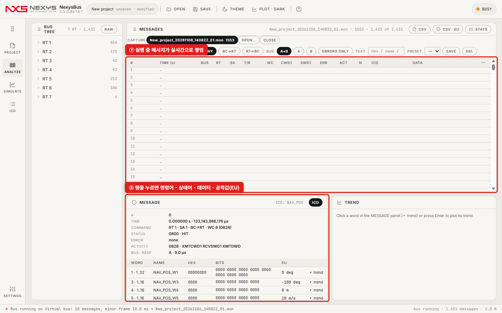
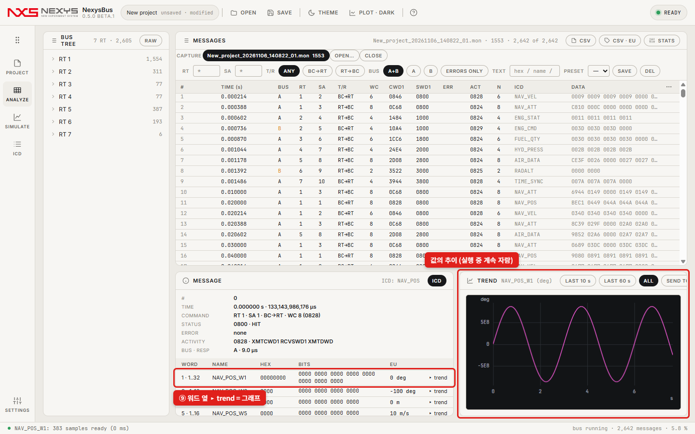
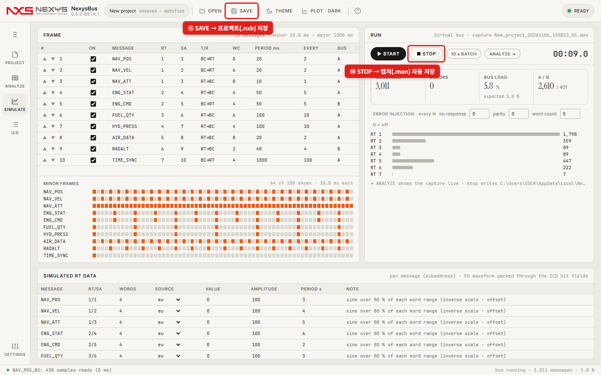

# 카드 없이 버스 돌려 보기 — 가상 버스 (빠른 시작)

**이런 경우에 씁니다**: 1553 카드가 없지만 ICD대로 버스를 돌려 보고, 메시지와 값(공학값)을 확인하고 싶을 때. PC 한 대, **설치할 것 없음**.

```
 [ ICD (CSV) ] → [ NexysBus: BC 프레임 + 시뮬레이트 RT + 모니터 (가상 버스) ] → [ 목록 · 값 · 그래프 · 캡처(.mon) ]
```

준비물: NexysBus(설치형 또는 포터블), ICD 파일 하나. 없으면 예제 [`examples/bus-example-icd.csv`](examples/bus-example-icd.csv)(메시지 10개 · 워드 40개)로 시작하세요.

---

## 1단계. ICD 파일 (메시지 · 워드 정의)

CSV/XLSX에 **워드 하나당 한 줄**입니다. 예제를 Excel로 열어 내 ICD로 고치면 됩니다.

| 열 | 예제 값 | 뜻 |
|---|---|---|
| `message` | NAV_POS | 메시지 이름 |
| `rt` · `sa` · `tr` · `wc` | 1 · 1 · 0 · 8 | RT 주소 · 서브어드레스 · 방향(0 = BC→RT, 1 = RT→BC) · 워드 수 |
| `period_ms` | 20 | 메시지 주기(ms) |
| `bus` | A | 버스 A / B |
| `word` · `bit_start` · `bit_len` | 3 · 1 · 16 | 몇 번째 워드의 몇 번째 비트부터 몇 비트 |
| `type` | BNR | BNR · BCD · Discrete · UINT · INT … |
| `scale` · `offset` · `unit` | 0.01 · −100 · deg | 공학값 = 원시값 × scale + offset |
| `name` | NAV_POS_W3 | 워드 이름 |

## 2단계. NexysBus에서 (빨간 박스대로)

**① 시작 화면에서 NEW PROJECT**



**② 장치는 Virtual bus(기본 선택)** — 카드 없이 소프트웨어가 BC · RT · 모니터 역할을 모두 합니다. 버스 설정(MINOR FRAME 등)은 그대로 둬도 됩니다.



**③ 왼쪽 레일 ICD → CHOOSE FILE… → ICD 파일 선택**



**④ 열 이름은 자동으로 맞춰집니다 → IMPORT … ROWS**. 가져온 메시지가 곧바로 프로젝트의 프레임이 됩니다.



**⑤ 왼쪽 레일 SIMULATE — 메시지 · 주기(ms)를 확인(표에서 바로 고침) · ⑥ START**. `10 s BATCH`는 10초 분량을 즉시 만들어 줍니다(결과 확인용).



**⑦ 왼쪽 레일 ANALYZE — 실행 중 메시지가 실시간으로 쌓이고, ⑧ 행을 누르면 명령어 · 상태어 · 데이터와 공학값(EU)이 보입니다.**



**⑨ 워드 옆 ▸ trend = 그래프**(실행 중 계속 자람, `SEND TO VIEW`로 Nexys VIEW에 넘기기)



**⑩ SIMULATE에서 STOP → 캡처(.mon)가 자동 저장 · ⑪ 상단 SAVE → 프로젝트(.nxb) 저장**. 다음엔 프로젝트를 열고 ⑥부터 하면 됩니다.



---

## 더 해 볼 것

| 하고 싶은 것 | 어디서 |
|---|---|
| RT가 보내는 값 바꾸기(사인 · 램프 · 고정값) | SIMULATE 아래 **SIMULATED RT DATA**의 SOURCE |
| 오류 넣어 보기(무응답 · 패리티 · 워드 수) | SIMULATE의 **ERROR INJECTION** — N번째 메시지마다 |
| 오류만 보기 | ANALYZE 필터의 **ERRORS ONLY** |
| 목록을 CSV로 | ANALYZE 위쪽 **CSV**(원시) · **CSV · EU**(공학값) |
| 실제 카드로 같은 프레임 돌리기 | [6. 하드웨어 카드](06-hardware.md) — PROJECT에서 카드 선택 후 같은 START |

## 안 될 때

| 증상 | 확인 |
|---|---|
| IMPORT 뒤 SIMULATE 표가 비어 있음 | ICD에 `message` · `rt` · `sa` 열이 있는지(빨간 `req` 칸), 미리보기에 행이 보였는지 |
| 값(EU)이 이상함 | ICD의 `word` · `bit_start` · `bit_len` · `type` · `scale` · `offset` |
| BUS LOAD가 너무 높음 | 주기(ms)가 너무 짧거나 워드 수가 많음 — SIMULATE 표의 `expected` 부하를 보며 조정 |

더 자세한 설명은 [4. SIMULATE](04-simulate.md) · [5. ANALYZE](05-analyze.md).
